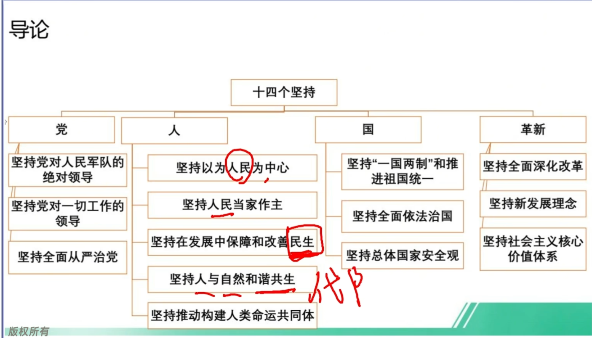

# 习概新思想 

一. 习近平新时代中国特色社会主义思想创立的时代背景
1. 世界`百年未有之大变局`加速演进。
2. 中华民族伟大复兴进入`关键时期`。
3. `中国式现代化`全面推进拓展。
4. 科学社会主义在21世纪的中国焕发新的`蓬勃生机`。
5. 中国共产党`自我革命`开辟新的境界

二. 习近平新时代中国特色社会主义思想是“两个结合”的重大结果
特别要注意理解`马克思主义(魂脉)`与`中华优秀传统文化(根脉)`之间的关系。
(1)坚守好`魂(马克思主义)和根（中华优秀传统文化）`,是理论创新的`基础和前提`。
(2)`中华优秀传统文化`是中华文明的智慧结晶和精华所在，是`中华民族的根和魂`，是我们在世界文化激荡中站稳脚跟的`根基`，是我们党创新理论的`“根”`。

习近平新时代中国特色社会主义思想是马克思主义基本原理同`中国具体实际`相结合，同`中华优秀传统文化`相结合的重大成果，是坚持“两个结合”的光辉典范。“两个结合”是我们党在探索中国特色社会主义道路中得出的`规律性认识`，是我们取得成功的`最大法宝`。

三，习近平新时代中国特色社会主义思想是完整的科学体系
1. 科学回答的重大时代课题：`新时代坚持和发展什么样的中国特色社会主义，怎样坚持和发展中国特色社会主义`，建设什么样的社会主义现代化强国，怎样建设社会主义现代化强国，建设什么样的长期执政的马克思主义政党，怎样建设长期执政的马克思主义政党。

科学体系= 十个明确 十四个坚持 十三个方面成就 + 六个必须坚持 世界观 方法论

1. 十个明确
明确中特色的总任务是实现`社会主义现代化和中华民族伟大复兴`。
明确新时代我国社会主要矛盾是`人民日益增长的美好生活需要和不平衡不充分发展之间的矛盾`
明确中特色的`总体布局`是`五位一体`（政治建设，经济建设，文化建设，社会建设，生态文明建设），`战略布局`是`四个全面`(全面建设社会现代化国家，全面深化改革，全面依法治国，全面从严治党)。
明确全面深化`改革的总目标`是`完善和发展中国特色社会主义制度，推进国家治理体系和治理能力的现代化`。
明确全面推进`依法治国总目标`是建设`中国特色社会主义法治体系，建设社会主义法治国家`。

明确党在新时代的`强军目标`是建设一支`听党指挥，能打胜仗，作风优良的人民军队`。
明确中国特色`大国外交`要服务民族复兴，促进人类进步（主线），推动`构建新型国际关系，推动构建人类命运共同体(总目标)`。
明确中国特色社会主义`最本质的特征`是`中国共产党的领导，全党必须增强四个意识，坚定四个自信，做到两个维护`。
明确必须坚持和完善`社会主义基本经济特征`，使`市场`在资源配置中起决定性作用，更好发挥政府作用，把握新发展阶段，贯彻`创新`，`协调`，`绿色`，`开发`，`共享`的新发展理念，加快构建以国内大循环为主体，国内国际双循环相互促进的新发展格局，推动高质量发展，统筹发展和安全
明确全面从严治党的战略方针，提出新时代党的建设总要求，全面推进党的`政治建设`，`思想建设`，`组织建设`，`作风建设`，`纪律建设`，`把制度建设`贯穿其中，深入推进反腐败斗争，落实管党治党政治责任，以伟大自我革命引领伟大社会革命

十四个坚持
坚持党对一切工作的领导
坚持以为人民为中心
坚持全面深化改革
坚持新发展理念
坚持人民当家作主
坚持全面依法治国
坚持社会主义核心价值观体系
坚持在发展中保障和改善民生
坚持人和自然和谐共生
坚持总体国家安全观
坚持党对人民军队的绝对领导
坚持“一国两制”和推进国家统一
坚持推动构建人类命运共同体
坚持全面从严治党

六个必须坚持
1. 坚持`人民至上`是根本价值立场，体现了历史唯物主义群众史观
2. 坚持`自信自立`是内在精神特质，体现了客观规律性和主观能动性的有机结合。
3. 坚持`守正创新`是内在精神特质，体现了变与不变，继承与发展的内在联系
4. 坚持`问题导向`是重要实践要求，体现了矛盾的普遍性和客观性。
5. 坚持`系统观念`是基本思想和工作方法，体现了辩证唯物主义普遍联系的原理
6. 坚持`胸怀天下`是中国共产党人的境界格局，体现了马克思主义追求人类进步和解放的崇高理想

坚持道路自信，理论自信，制度自信，文化自信
1. 改革开发以来我们`取得一切成绩和进步的根本原因`，归结起来就是：开辟了中国特色社会主义道路，形成了中国特色社会主义理论体系，确立了中国特色社会主义制度，发展了中国特色社会主义文化。其中，`道路是实现途径，理论体系是行动指南，制度是根本保障，文化是精神力量`，四者统一于中国特色社会主义伟大实践。
2. 新时代坚持和发展中国特色社会主义，必须坚定四个自信。
3. 中国特色社会主义四个自信，`来源于实践，来源于人民，来源于真理`。
4. 坚定中国特色社会主义四个自信，`中国共产党和中国人民有着深厚的根基和底气`

中国特色社会主义新时代是我国发展新的历史方位

1. 党的`十九大`作出中国特色社会主义进入新时代这个重大政治论断。`新时代`是我国发展新的历史方位，标志着中国特色社会主义事业进入了`新的发展阶段`。

2. 中国特色社会主义进入了`新时代的内涵`

1. 历史性：承前启后，继往开来，在新的历史条件下继续夺取`中国特色社会主义伟大胜利`的时代。
2. 实践性：决胜`全面建成小康社会`，进而`全面建设社会主义现代化强国`的时代。
3. 人民性：全国各族人民团结奋斗，不断创造美好生活，逐步实现全体人民`共同富裕`的时代。
4. 民族性：全体中华儿女协力同心，奋力`实现中华民族伟大复兴中国梦`的时代。
5. 世界性：这个新时代是我国日益`走进世界`舞台中央，不断为人类作出更大贡献的时代。

3. 中国特色社会主义进入新时代的依据

1. 是我国`社会主要矛盾发生新变化`的反映。是我们党作出中国特色社会主义进入新时代重大判断的基本依据。
2. 是`党的主要任务发生新变化`的反映。
3. 是`中国和世界关系发生新变化`的反映。

社会主要矛盾变化是关系全局的历史性变化

新矛盾：人民日益增长的`美好生活需要和不平衡不充分`的发展之间的矛盾的重大战略判断。

1. 新时代我国社会主要矛盾的变化，反映了社会发展的客观实际，明确了解当代中国发展主要问题的根本着力点。
2. 新时代我国社会主要矛盾的变化，是关系全局的历史性变化，对党和国家工作提出了许多新要求。
3. 我国仍处于并将`长期处于社会主义初级阶段的基本国情没有变`，我国是世界最大的发展中国家的`国际地位没有变`。

新时代伟大变革及其里程碑意义

1. 走过百年奋斗历程的中国共产党在革命性锻造中更加`坚强有力`，在坚持和发展中国特色社会主义的历史进程中始终成为坚强`领导核心`.
2. 中国人民的前进动力更加强大，必胜信念更加坚定，焕发出更为强烈的历史自觉和主动精神。
3. 改革开放和社会主义现代化建设深入推进，书写了经济快速发展和社会长期稳定两大奇迹新篇章，我国发展具备了`更为完善的制度保证`，实现中华民族伟大复兴进入了`不可逆转`的历史进程。
4. 科学社会主义在21世纪的中国焕发出新的`蓬勃生机`，中国式现代化为人类实现现代化提供了`新的选择`。

全面贯彻党的基本理论，基本路线，基本方略
党的基本理论，基本路线，基本方略，事关党的前途命运，事关中国特色社会主义事业兴衰成败。
1. 党的基本理论是坚持和发展中国特色社会主义的行动指南。
2. 党的基本路线是国家的生命线，人民的幸福线。
3. 基本方略-十四个坚持，反映了我们党对建设中国特色社会主义的规律性认识。

统筹推进 五位一体 总体布局和协调推进 四个全面 战略布局
1. 五位一体 `总体布局`是指经济建设，政治建设，文化建设，社会建设，生态文明建设
2. 四个全面 `战略布局`是指全面建设社会主义现代化国家，全面深化改革，全面依法治国，全面从严治国。

(了解)
推动中国特色社会主义不断开拓前进
社会主义是前无古人的伟大事业，没有现成的方案可以遵循，必须随着时代，实践和科学的发展不断探索前进。
1.社会主义是一个`不断发展和完善`的实践过程，需要一代又一代人的接续奋斗
2.社会主义发展道路从来都不是笔直的，始终`充满着险阻曲折`，需要依靠顽强斗争打开事业发展新天地。
3.在人类社会的漫漫历史长河中，社会主义发展的历史不算长，然而，社会主义的理论和实践，却深刻`改变了亿万人民的命运`，影响了人类历史发展的方向。

`实现中华民族的伟大复兴，就是中华民族近代以来最伟大的梦想。`
中国梦=中华民族伟大复兴=现代化强国=第二个百年奋斗目标

中国梦的本质 (主观题)
`国家富强` (基础 保障 前提)
`民族振兴` ()
`人民幸福` (出发点，落脚点，根本目的，归宿)

2020-2035
我国发展的总体目标
1. 人均国内生成总值迈上新的打台阶，达到`中等发达`国家水平。
2. 实现高水平科技自立自强，`进入创新型国家前列`；
3. 建成现代化经济体系，形成新发展格局。
4. 生态环境根本好转，美丽中国目标`基本实现`。
5. 人的全面发展，`全体人民共同富裕取得更为明显的实质性进展`

2035-2050
1. 把我国建设成为富强民族文明和谐美丽的`社会主义现代化强国`
2. `全体人民共同富裕基本实现 `

1. 坚持`党的全面领导/改革开发`是坚持和发展中国特色社会主义的必由之路。
2. `中国特色社会主义`是实现中华民族伟大复兴的必由之路。
3. `团结奋斗`是中国人民创造历史伟业的必由之路。
4. 贯彻`新发展理念`是新时代我国发展壮大的必由之路。
5. `全面从严治党`是党永葆生机活力，走好新的赶考之路的必由之路。

`自主创新` 是我们攀登世界科技高峰的必由之路
`开放` 是国家繁荣的必由之路
`依法治港治澳`，是全面准确贯彻 “一国两制” 方针的必由之路

新民主主义革命时期：我们党团结带领人民进行革命斗争，取得新民主主义革命的胜利，为实现现代化创造了`根本社会条件`。
社会主义革命和建设时期：我们党带领人民完成了社会主义革命，推动了社会主义建设，为现代化建设奠定了`根本政治前提和制度基础`，提供了`宝贵经验，理论准备，物质基础`。
改革开发和社会主义现代化建设新时期：我们党作出把党和国家工作中心转移到经济建设上来，实行改革开放的历史性决策，开启了中国现代化的新长征，为中国式现代化提供了`充满新的活力体制保证和快速发展的物质条件`。
进入新时代：我们党围侥解决现代化建设中存在的突出矛盾和问题，不断实现理论和实践上的创新突破，成功推进和拓展了中国式现代化。创立了习近平新时代中国特色社会主义思想，实现了马克思主义中国化时代化新的飞跃，为中国式现代化提供了根本遵循；实现`一系列突破性进展，取得一系列标志性成果`，推动党和国家事业取得历史性成就，发生历史性变革，为中国式现代化`提供了更为完善的制度保证，更为坚实的物质基础，更为主动的精神力量。`

中国现代化的本质要求(主)
1. 本质要求(9条)：坚持中国共产党领导，坚持`中国特色社会主义`，实现`高质量发展`，发展`全过程人民民主`，丰富人民`精神`世界，实现`全体人民共同富裕`,促进`人与自然和谐共生`，推动构建`人类命运共同体`，创造`人类文明新形态`
这一本质要求符合人类现代化的一般规律，阐明了中国式现代化的内在规定性，明确了中国式现代化的领导力量，发展道路和根本方向，总体布局和战略要求，以及对人类文明和世界发展的重大意义，是推进中国式现代化的重要遵循。

中国式现代化的中国特色（主观题）
1. 中国式现代化是`人口规模`巨大的现代化 -- 显著特征
2. 中国式现代化是`全体人民共同富裕`的现代化 -- 本质特征/中国现代化区别于西方现代化的`显著标志`
3. 中国式现代化是`物质文明和精神文明`相协调的现代化 -- 崇高追求  物质富足，精神富有是社会主义现代化的`根本要求`
4. 中国式现代化是`人与自然和谐共生`的现代化 -- 鲜明特点
5. 中国式现代化是`走和平发展道路`的现代化 -- 突出特征

为什么要强调党在中国式现代化建设中的领导地位？(主)
中国式现代化是`中国共产党领导`的社会主义现代化，这是中国式现代化的`定性，是管总体，管根本的`。党的领导直接关系中国式现代化的`根本方向`，`前途命运`，`最终成败`。
1. 党的领导决定中国式现代化的根本性质 (是社会主义现代化)。
2. 党的领导确保中国现代化锚定奋斗目标行稳致远 (一代一代地接力推进)。
3. 党的领导激发建设中国式现代化的强劲动力(改革开放)。
4. 党的领导凝聚建设中国式现代化的磅礴力量(汇集全体人民的智慧和力量)。

中国式现代化创造了`人类文明新形态`/中国式现代化的意义(主)
中国式现代化，深深值根于中华优秀传统文化，体现科学社会主义的先进本质，借鉴吸收一切人类优秀文明成果，代表人类文明进步的发展方向，是一种全新的人类文明形态
1. 中国式现代化提供了一种`全新的现代化模式`。打破了 “现代化=西方化” 的迷思
2. 中国式现代化是对西方现代化理论和实践的`重大超越`。是对世界现代化理论和实践的重大创新
3. 中国式现代化为广大发展中国家提供了`全新选择`。

推进中国式现代化需要牢牢把握的重大原则(主)
1. 坚持和加强`党`的全面领导。 (领导力量)
2. 坚持中国`特色社会主义`道路。(旗帜方向)
3. 坚持以`人民`为中心的发展思想。(价值立场)
4. 坚持深化`改革开放`。(根本动力)
5. 坚持发扬`斗争精神`。(精神状态)

推进中国式现代化需要正确处理的重大关系(了解)
1. 正确处理顶层设计与实践探索的关系。
2. 正确处理战略与策略的关系。
3. 正确处理守正与创新的关系。
4. 正确处理效率与公平的关系。
5. 正确处理活力与秩序的关系
6. 正确处理自立自强与对外开放的关系。
    `独立自主`是`中华民族精神之魂`，是我们立党立国对重要原则。
    `对外开放`是中国的`基本国策`，任何时候都不能动摇。

推进中国式现代化必须坚持团结奋斗
1. `团结就是力量，奋斗开创未来`。
2. 中国民族是有着`伟大团结奋斗精神`的民族。
3. 中国式现代化是一个伟大而艰巨的事业，前进道路必然风雨兼程，需要全党全国各族人民`团结奋斗`的步调更加一致，意志更加顽强。
4. `团结奋斗`是中国共产党和中国人民`最显著的精神标识`，是中国人民创造历史伟业的`必由之路`。

一. 中国最大的国情就是`中国共产党的领导` (主观题)
1. 中国共产党是中国特色社会主义事业的`坚强领导核心`。
2. 中国共产党是`最高政治领导力量`。
3. 中国共产党是`人民当家作主`的可靠保障。
4. 中国共产党领导关系`中国特色社会主义的性质，方向和命运`。中国特色社会主义之所以是社会主义，究其`根本`就在于坚持科学社会主义基本原则，在于坚持中国共产党的领导。
5. 党的领导是党和国家的根本所在，命脉所在，是全国各族人民的利益所系，命运所系
6. 是`实现中华民族伟大复兴`的`根本保证`。

二. `中国共产党领导`是中国特色社会主义制度的最大优势.(最显著优势) (主观题)
1. 中国共产党以马克思主义作为行动指南，在实践中不断推进马克思主义中国化时代化，为坚持和完善中国特色社会主义制度提供`强大理论优势`。
2. 中国共产党的自身优势是中国特色社会主义制度优势的`主要来源`。
3. 中国共产党能够集中全党全国力量，凝聚全民族共同意志，在各项事业中发挥总揽全局，协调各方的作用，确保中国特色社会主义制度的`显著优势充分彰显`。

三. 加强党的全面领导为新时代党和国家事业发展提供了坚强保证 (主)
1. 使党的``领导核心``作用充分彰显
2. 使党的政治领导力，思想引领力，群众组织力，社会号召力`显著增强`。
3. 为推进新时代中国特色社会主义事业提供了`政治保证`，使党成为风雨来袭时中国人民`最可靠的主心骨`。

一。中国共产党是最高政治领导力量
1. 中国共产党得到了最广大人民群众的支持和拥护，得到了各民主党派，各团体，各民族，各阶级，各界人士的支持和拥护。中国共产党作为最高政治领导力不是自封的，而是在`历史发展中`形成的。
2. 中国共产党作为最高政治领导力量是由`我国国家性质和政治制度体系`决定的。中国共产党是我国`最高政治领导力量`，`党的领导制度`在我国国家政治制度体系中居于`统治地位`。
3. 中国共产党作为最高政治统治力量是由`中华民族伟大复兴事业`定的。

二。 党的领导是全面的，系统的，整体的
1. 党的领导是`全面`的，体现在领导对象上，领导内容上，领导过程中，领导方式上。
2. 党的领导是`系统`的，体现在党在推进各项事业发展中发挥着把方向，谋大局，定政策，促改革的作用，通过总揽全局，协调各方，把党的领导落实到国家治理各领域各方面各环节。
3. 党的领导是`整体`的，党要完整发挥领导功能，无论是党的中央还是地方组织，基层组织，都要按照党章的规定发挥各自作用。
党的领导作用贯穿于工作全过程---党对一切工作都领导

三。维护党中央权威和集中统一领导(主观题)
`党中央集中统一领导`是党的领导的`最高原则`，是党保持团结统一和强大战斗力，不断取得胜利的关键所在。
1. 是一个成熟的马克思主义执政党的`重大建党`原则。
2. 必须坚决贯彻`党的理论，路线方针政策和党中央`决策部署。
3. 最关键的是坚决维护习近平同志`党中央的核心，全党的核心地位`。
4. 中国共产党是以`民主集中制为根本组织原则`和领导制度的马克思主义政党。

一。党的领导制度是我国家的根本制度
中国共产党领导 是`国家治理体现的核心`
党的领导制度   是`中国特色社会主义制度建设的关键`  是`中国特色社会主义制度体现的核心` 是`国家治理体现和治理能力现代化的关键`

党的领导制度主要内涵 (主观题)
1. 建立`不忘初心，牢记使命`的制度。 --- `坚实基础`
2. 完善坚定`维护党中央权威和集中统一领导`的各项制度 --- `最高原则`
3. 健全党的`全面领导`制度 --- `主体内容`
4. 健全`为人民`执政，`靠人民`执政各项制度 --- `价值追求`
5. 健全`提高党的执政能力和领导水平`制度 --- `实践要求`
6. 完善全面`从严治党`制度 --- `坚定保证`

二. 健全党中央对重大工作的领导体制
`党中央对重大的领导体制，是加强党的全面领导的制度安排，是实现党的全面领导的直接体现。`
1.`请示报告制度`：早在土地革命战争时期，我们党就确立了各省委向中央报告的制度，要求各地及时向中央报告工作。1948年年初，毛泽东为中共中央起草《关于建立报告制度》的党内指示，推动建立健全全党全军向中央报告工作的制度，加强了党中央对重大工作的领导。
2.加强党中央对重大工作的领导，必须完善党中央`重大决策部署落实机制。党的中央委员会，中央政治局，中央政治局常委会，是党的领导决策核心`。党中央作出的决策部署，党的各个部门，各类国家机关的党组织，人民团体，企事单位等的党组织要贯彻落实。

一. 人民是历史的创造者，是真正的英雄。(主观题)
1. `人民`是创造历史的`真正动力`，是历史发展和社会进步的`主体力量`。
2. 尊重人民历史地位，充分发挥人民主体作用，这是总结党的百年奋斗历史经验得出的重要结论。
3. `人民性`是马克思主义的`本质属性和鲜明品格`
4. `坚持以人民为中心`，是新时代坚持和发展中国特色社会主义的`根本立场`，是贯穿党治国理政全部活动的`一条红线`。
`根本原因`就在于`我们党始终坚守了为中国人民谋幸福，为中华民族谋复兴的初心和使命`。

二. 打江山，守江山，守的是人民的心(主观题)
1. `民心/人心是最大的政治（中国共产党的根本执政规律）`，决定事业兴衰成败
2. 江山就是人民，人民就是江山，这是由我们`党的性质，宗旨`决定的
3. 党代表最广大人民的根本利益，这就要求党必须始终坚持`全心全意为人民服务的宗旨`

三. 人民立场是中国共产党的根本政治立场
1. `人民立场`是中国共产党的`根本政治立场`，是我们党区别于其他政党的``显著标志``
2. 坚持这一根本立场，就要坚持以人民为中心的执政理念，将其贯穿于党和国家事业发展各方面
    1. 坚持人民立场，就要始终牢记`党的初心和使命`
    2. 坚持人民立场，就要始终保持`党同人民群众的血肉联系`。我们党的`最大政治优势`是`密切联系群众`，党执政后最大危险是脱离群众
    3. 坚持人民立场，就要`热爱人民，尊重人民，敬畏人民`

一. 人民对美好生活的向往就是党的奋斗目标(主观题)
1. 坚持人民至上，是我们党百年奋斗的宝贵历史经验，也是新时代党治国理政的`根本价值取向`。坚持人民至上，必须始终把人民放在心中最高的位置，`想人民之想，行人民所嘱`。
2. 为`人民谋幸福`是党始终坚守的初心，让人民过上好日子是党一贯的追求。
3. `人民对美好生活的向往`就是党的奋斗目标，这体现了我国社会主要矛盾转化对党和国家工作的新要求。必须牢牢把握我国社会主要矛盾的新变化，顺应人民对高品质生活的新期待，在高质量发展中努力为人民创造更美好，更幸福的生活。

二. 人民是党的工作的最高裁决者和最终评判者
1. 时代是出卷人，我们是答卷人，人民是阅卷人。`人民`是党的工作的最高裁决者和最终评判者。
2. 让`群众满意`是我们党做好一切工作的`价值取向和根本标准`。
3. 人民是我们党执政的最大底气，也是党执政最深厚的根基。

三. 依靠人民创造历史伟业（主观题）
1. 人民是我们党的`生命之根，执政之基，力量之源。`人民群众是共产党安身立命之本。
2. 依靠人民创造历史伟业的要求
    1. `必须尊重人民主体地位。`
    2. `必须尊重人民首创精神。`

一. 改革开放是我们前进的重要法宝(主观题)
1. 改革开放是我们党的一次`伟大觉醒`
2. 改革开放是决定当代中国命运的`关键一招`，也是决定实现“两个一百年”奋斗目标，实现中国民族伟大复兴的`关键一招`
3. 改革开放是党和人民大踏步赶上时代的`重要法宝`
4. 改革开放是当代中国`最显著的特征`，最壮丽的气象
5. 改革开放是坚持和发展中国特色社会主义的``必由之路``，是当代中国发展进步的``活力之源``
6. 全面深化改革开放是完成新时代目标任务的``必然要求``

二. 新时代全面深化改革开放是一场深刻革命(主观题)
1. 新时代全面深化改革开放，就其`艰巨性，复杂性和系统性`来说，是一场`深刻的革命`。
2. 新时代的改革开放是全方位，深层次，根本性的，取得的成就就是历史性，革命性，开创性的，这体现了中国特色社会主义制度的鲜明特征和显著优势。
3. 全面深化改革开放是在多年改革开放基础上的深化，是一场`全面，系统，整体`的制度创新，必须将其作为系统工程来把握

三. 如何坚持全面深化改革开放的正确方向(主观题)
1. 必须坚持和改善`党的全面领导`，坚持和完善中国特色社会主义制度
2. 必须坚持以`人民`为中心，促进社会公平正义，增进人民福祉。社会主义改革开放的`出发点和落脚点`，是为了让老百姓过上好日子。要把人民满意不满意，高兴不高兴作为`根本标准`。
3. 必须有利于`进一步解放思想，进一步解放和发展生产力，进一步解放和增强社会活力`

进一步全面深化改革的总目标到2035年 20届三中 (主观题)
1. `全面建成`高水平社会主义市场经济体制
2. 中国特色社会主义`制度更加完善`
3. `基本实现`国家治理体系和治理能力现代化
4. `基本实现`社会主义现代化，为到本世纪中叶全面建成社会主义现代化强国奠定决定基础

20届三中(主观)
原则
1. 坚持党的全面领导
2. 坚持以人民为中心
3. 坚持守正创新
4. 坚持以制度建设为主线
5. 坚持全面依法治国
6. 坚持系统观念

推进国家治理体系和治理能力现代化的要求(主观)
1. 必须决定中国特色社会主义制度``自信``
2. 必须更好`发挥`中国特色社会主义`制度优势`
3. 必须把中国特色社会主义制度的优势`转化为国家治理效能`

改革开放永无止境的原因(主观题)
1. 是`社会基本矛盾运动规律`的深刻反映
2. 是`总结世界社会主义实践经验`得出的重要结论
3. 是`推进党和人民事业发展`的必然要求

对社会主义基本经济制度的新概括及其意义(主观题)
将`按劳分配为主体，多种分配方式`并存，`社会主义市场经济`体制，与`公有制为主体，多种所有制经济`共同发展一起，共同作为社会主义基本经济制度的内容。

大力推动构建新发展格局
1. 着力推动实施扩大内需战略同深化供给侧结构性改革有机结合。``要坚持深化供给侧结构性改革这条主线``，发挥创新第一动力作用，要以满足国内需求为基本立足点。
2. 着力发展`实体经济`。实体经济是一国经济的立身之本，财富之源，是构筑未来发展战略优势的重要支撑。-- 发展经济的着力点是实体经济
3. 着力加快`科技自立自强`。 -- `构建新发展格局最本质的特征是实现高水平的自立自强`。科技自立自强是我国经济生存和发展的基础，是畅通国内国际双循环，促进我国发展大局的关键。
4. 着力推动`产业链供应链`优化升级。

一. 建设现代化经济体系
`建设现代化经济体系`是我国发展的战略目标，是`推动高质量发展，全面提高经济整体竞争力`的`必然要求`
1. `现代化产业体系`是国家经济现代化的`重要标志`
2. 加快建设以实体经济为支撑的`现代化产业体系`（主观题）
    1.``巩固`优势产业`领先地位。``保持优势产业的领先地位，是支撑我国国际竞争力的基础
    2. ``大力发展战略性新兴产业``。`战略性新兴产业具有先导性`，代表新一轮科技革命和产业变革的方向，是引领国家未来产业发展的`决定性力量`
    3. ``构建优质高效的服务业新体系``。`现代服务业`是现代化产业体系的`重要支撑`
    4. ``发展现代流通产业``
    5. `加快发展数字经济。`数字经济正在成为`新一轮国际竞争的重点领域`
    6. `构建现代化基础设施体系`。基础设施是经济社会发展的重要支撑。

深入实施科教兴国战略，人才强国战略，创新驱动发展战略(主观题)
1. 重要性：实施科教兴国战略，人才强国战略，创新驱动发展战略，是增强综合国力，满足人民群众美好生活需要的必然要求，是建设教育强国，科教强国，人才强国的重大举措。
2. 科教兴国战略，就是要全面落实`科学技术是第一生产力`的思想。科教兴国是我国的基本国策，实施科教兴国战略，要把教育摆在优先发展的战略地位。
3. 人才强国战略，就是要牢固树立`人才资源是第一个资源`的理念。
4. 创新驱动发展战略，就是要坚持`创新是第一动力`。创新在`国家发展全局中居于核心位置`

坚持教育优先发展，科教自立自强，人才引领驱动(主观题)
1. 教育优先发展，重在夯实人力资源深度开发基础，是`推动党和国家各项事业发展`的`重要先手棋`
2. `科技自立自强`，重在坚持独立自主开拓创新是决定我国生成和发展的基础能力，对于更好掌握全球经济科技`竞争先机具有战略意义`
3. `人才引领驱动`，重在巩固发展优势赢得竞争主动。是经济社会发展和国家现代化的`基本规律`，对于应对激励的国际竞争，发挥我国发展潜在力量和后发优势具有`基础性战略意义`

为什么要加快建设教育强国(主观题)
1. 建设`教育强国`是`全面建成社会主义现代化强国`的`战略先导`，是实现高水平科技自立自强的`重要支撑`，是促进全体人民共同富裕的`有效途径`，是以中国式现代化全面推进中华民族伟大复兴的`基础工程`
2. 教育是民族振兴，社会进步的基石，是国之大计，党之大计，是功在当代，利在千秋的`德政工程`，对提高人民综合素质，促进人的全面发展，增强中华民族创新创造活力，`实现中华民族伟大复兴`具有`决定性意义`
3. 教育是`国家经济社会发展`的`支撑力量`，在国家发展中始终具有`基础性先导性全局性地位`

实现高水平科技自立自强的必要性(主观题)
1. `实现高水平科技自立自强是国家强盛和民族复兴的战略基石`。全面建成社会主义现代化强国关键看科技自立自强，这是促进发展大局的根本支撑。
2. 实现高水平科技自立自强是应对风险挑战和维护国家利益的必然选择。`科技自立自强是国家强盛之基，安全之要`
3. 实现高水平科技自立自强是`构建新发展格局，推动高质量发展，满足人民美好生活需要的内在要求`

为什么要打赢关键核心技术攻坚战(主观题)
1. 关键核心技术是国之重器，只有把最关键最核心的技术掌握在自己手中，才能从根本保障国家经济安全，国防安全和其他安全
2. 关键核心技术必须掌握自己手中，`核心技术受制于人是我们最大的隐患`

如何打赢关键核心技术攻坚战（主观题）
1. 必须深入推进科技体制改革。`科技领域的改革最紧迫的是要破除体制机制障碍`，最大限度解放和发展科技作为第一生产力所蕴藏的巨大潜能
2. 发挥新型举国体制优势开展科技攻关

中国特色社会主义政治制度行得通，有生命力，有效率(主观题)
1. 中国特色社会主义政治制度是有`根本政治制度，基本政治制度，重要政治制度`等组成的制度体系。人民代表大会制度是坚持党的领导，人民当家作主，依法治国有机统一的`根本政治制度`安排，中国共产党领导的多党合作和政治协商制度，民族区域自治制度以及基层群众自治制度构成我国的``基本政治制度``。在根本政治制度，基本政治制度基础之上，形成了一系列具有中国特色的重要政治制度。这些制度共同构成了`中国特色社会主义政治制度的四梁八柱`。
2. 中国特色社会主义政治制度具有鲜明的中国特色
3. 中国特色社会主义政治制度在实践中显示出巨大优势

全过程人民民主是社会主义民主政治的伟大创造(主观题)
1. 过程民主和成果民主的统一
2. 程序民主和实质民主的统一
3. 直接民主和间接民主的统一
4. 人民民主和国家意志的统一
全过程人民民主始终将实现`最广大人民根本利益`作为民主政治建设的`出发点和落脚点`
全过程人民民主是新时代我国民主政治领域具有`重大创新意义的标志性成果`

全过程人民民主是全链条，全方位，全覆盖的民主(主观题)
1. 全链条：全过程人民民主把民主选举，民主协商，民主决策，民主管理，民主监督贯通起来，形成全过程人民民主的完整链条
2. 全方位：全过程人民民主贯通国家政治生活和社会生活各层面各维度
3. 全覆盖：全过程人民民主涵盖国家各项事业各项工作，贯穿“五位一体”总体布局和“四个全面”战略布局的方方面面，是各方面民主的有机统一

全过程人民民主是最广泛，最真实，最管用的民主（主观题）
1. `全过程人民民主是最广泛的民主。`全过程人民民主是全体人民共同持续参与，各个民族平等享有，不同地域，不同领域，不同层级，不同群体均实现全覆盖的民主体系，是最广泛的民主
2. `全过程人民民主是最真实的民主。`全过程人民民主把党的主张，国家意志，人民意愿紧密融合在一起，充分彰显了人民的主体地位，彰显了人民民主的真实性。
3. `全过程人民民主是最管用的民主。`全过程人民民主体系了社会主义民主的优势，保证在党的领导下有效治理国家，保证人民依法行使权利，巩固平等团结互助和谐的社会主义民族关系，发展基层民主

怎么理解人民民主，全过程人民民主(更自信的中国对“民主”的解释权)(主观题)
1. 人民民主--社会主义直接相连(社会主义制度，应有之义，社会主义的生命)
2. 人民当家做主--社会主义民主政治的本质特征
3. 全过程人民民主：社会主义民主政治的本质属性：三全三最，具有显著优势

基本政治制度(主观题)
`中国共产党领导的多党合作和政治协商制度，民族区域自治制度，基层群众自治制度`构成了我国的`基本政治制度`，反映了我国社会主义民主政治的独特优势，是保障各政党，各阶层各民族和基层人民群众当家作主的重要基础
`中国共产党领导的多党合作和政治协商制度`是中国共产党，中国人民和各民主党派，无党人士的伟大政治创造。在人民民主的共同旗帜下，中国共产党与各民主党派`长期共存，互相监督，肝胆相照，荣誉与共`，形成“共产党领导，多党派合作，共产党合作，共产党执政，多党派参政”这一具有鲜明中国特色的新型政党制度。`中国人民政治协商会议`是实行中国共产党领导的多党合作和政治协商制度的重要机构

社会主义协商民主的内涵：(主观题)
1. 社会主义协商民主，是在中国共产党领导下，人民内部各方面围绕改革发展稳定重大问题和涉及群众切身利益的实际问题，`在决策之前和决策实施之中开展广泛协商，努力形成共识的重要民主形式`
2. `协商民主`是实践全过程人民民主的`重要形式`。
3. 协商民主是中国社会主义民主政治中`独特的，独有的，独到的民主形式`
4. 有事好商量，众人的事情由众人商量，找到全社会意愿和要求的最大公约数，是人民民主的真民主

统一战线的重要性(主观题)
统一战线是凝聚人心，汇聚力量的`强大法宝`，是中国共产党夺取，建设，改革事业胜利的`重要法宝`，也是实现中华民族伟大复兴的`重要法宝`

全面依法治国的唯一正确道路(主观题)
1. 我们党领导人民长期探索走出的`中国特色社会主义法治道路`，是全面依法治国的唯一正确道路。这条道路是由我国`社会主义国家性质`决定的，本质上是中国特色社会主义道路在法治领域的具体体现
2. 中国特色社会主义法治道路的`核心要义`，就是坚持`党的领导`，坚持`中国特色社会主义制度`，贯彻`中国特色社会主义法治理论`
3. 坚持和拓宽中国特色社会主义法治道路必须毫不动摇坚持的原则
    1. 坚持中国共产党的领导
    2. 坚持以人民为中心
    3. 坚持法律面前人人平等。平等是社会主义法律的基本属性
    4. 坚持依法治国和以德治国相结合
    5. 坚持从中国实际出发

统筹处理全面依法治国的重大关系(主观题)
1. 正确处理政治和法治的关系
(党vs法的关系是政治和法治关系的集中反映，是全面依法治国的一个`根本问题`)
2. 正确处理改革和法治的关系。(改革和法治相辅相成，相伴而生)
3. 正确处理依法治国和以德治国的关系
(都是治国理政不可或缺的重要手段，`法治`是治国理政的`根本方式`，`德治`是治国理政的`重要方式`)
4. 正确处理依法治国和依规治国的关系

为什么必须坚持依宪治国，依宪执政(主观题)
`宪法是国家的根本法`，是治国安邦的总章程，是党和人民意志的集中体现，是国家各种制度和法律法规的总依据，具有最高法律地位，法律权威，法律效力
`坚持依法治国首先要坚持依宪治国，坚持依法执政首先要坚持依宪执政`

坚持依宪治国，依宪执政的要求(主观题)
必须坚持党的领导地位和我国国体，政体不动摇
必须全面贯彻实施宪法（首页任务）
`宪法的生命在于实施，宪法的权威也在于实施`

建设更高水平的法治中国（主观题）
1. 完善以`宪政为核心`的中国特色社会主义法律体系
2. 扎实推进`依法行政`
3. 严格`公正司法`
4. 加快建设`法治社会`

文化繁荣兴盛是实现中华民族伟大复兴的必然要求(主观题)
1. 文化繁荣兴盛是实现`中华民族伟大复兴的精神支撑`
2. 文化繁荣兴盛是建设`社会主义现代化强国的应有之义`
3. 文化繁荣兴盛是满足`人民日益增长的美好生活需要的内在要求`
4. 文化繁荣兴盛是在世界文化激荡中`站稳脚跟的前提基础`

坚持中国特色社会主义文化自信（推动社会主义文化繁荣兴盛的关键）(主观题)
1. 坚定文化自信的重要性
文化自信是更基础，更广泛，更深厚的自信，是一个国家，一个民族发展中最基本，最深沉，最持久的力量。`建设社会主义文化强国，推动社会主义文化繁荣兴盛，关键在于坚定中国特色社会主义文化自信。`
2. 坚定文化自信的底气
    1. `中华优秀传统文化`是我们坚定文化自信的`深厚基础`。中华民族创造的优秀传统文化是`民族的根脉`，这是我们区别于其他国家和民族的根本特征，也铸成了中华民族一以贯之的文化自信
    2. 党带领人民在伟大斗争中孕育的`革命文化和社会主义先进文化`是我们坚定`文化自信的坚定基石`
    3. 中国特色社会主义`伟大实践`是我们坚定文化自信的`现实基础`

广泛践行社会主义核心价值观(主观题)
国家： 富强，民主，文明，和谐，
社会：自由，平等，公正，法治
公民：爱国，敬业，诚信，友善

如果实现新时代新的文化使命？（主观题）
1. 要坚强文化自信，坚持走自己的路，实现精神上的独立自主
2. 要秉持开发包容
3. 要坚持守正创新

民主是人民幸福之基（主观题）
1. 民主的重要性
    以人民为中心是我们党的根本执政理念，让人民生活幸福是“国之大者”
    `民生是人民幸福之基。`民生事关人民的生存生活生计，事关民心所向，民情所系，民意所指，坚定了事业成败和国家命运兴衰
2. 增进民生福祉的重要性
    `增进民生福祉`是坚持`立党为公，执政为民`的本质要求
    `增进民生福祉`是`社会主义生产`的根本目的
    增进民生福祉是全面建设社会主义现代化国家的应有之义。必须始终坚持把实现`人民对美好生活的向往`作为现代化建设的出发点和落脚点

根本目的，根本出发点落脚点 -- 人民
民生 -- 人民幸福之基，坚定党的事业成败和国家命运兴衰
增进人民福祉 -- 立党为公，执政为民的本质要求
前提 -- 正确把握民生和发展的关系
重中之重 -- 解决人民群众最关心最直接最现实的利益问题
具体的民生工程：
收入分配 -- 人民共享最直接最重要的方式
敬业 -- 最大最基本民生
社会保障 -- 社会建设的着力点
基础 --- 制度
民族昌盛重要标志 --- 健康
社会治理的理念 --- 共建共治共享

生态兴则文明兴(主观题)
1. 生态环境变化直接影响文明的兴衰演替
2. 生态文明是人类文明发展的历史趋势
