# 13180 操作系统2026年10月考前密押

2026年10月考期最新版

考生须知：

1、参考教材：《操作系统》，机械工业出版社，陈向群 孙卫真主编，2023年版。

2、特殊标记含义：P10代表教材页码第10页；<u>【 】</u>等标注的代表此处为重点关键词(得分点)。

一、单选题+填空题+简答题

1、计算机系统包括<u>【硬件系统和软件系统】</u>。硬件系统由中央处理器(CPU)、内存、外存储器(磁盘、磁带等)以及各种输入输出设备(键盘、鼠标、显示器、打印机等)组成；软件系统由各种程序和数据组成，包括应用软件、支撑软件和系统软件P26

2、<u>【操作系统】</u>是计算机系统中的一个系统软件，它是能有效组织和管理计算机系统中的硬件及软件资源，合理地组织计算机工作流程，控制程序的执行，并向用户提供各种服务功能，使得用户能够灵活、方便、有效地使用计算机，并使整个计算机系统高效运行的程序模块的集合P27

3、操作系统的特征：<u>【并发性、共享性、虚拟性、异步性】</u>P27-29

4、按照用户界面的使用环境和功能特征，一般可以把操作系统分为三种基本类型P38-42

(1)批处理操作系统：分为<u>【简单批处理系统、多道批处理系统】</u>；特点是<u>【成批处理】</u>。追求的目标是<u>【系统资源利用率高，作业吞吐率(指单位时间内计算机系统处理作业的个数)高】</u>

(2)分时操作系统：系统采用<u>【时间片轮转方式】</u>处理服务请求。将CPU的时间划分成若干个小片段，称为<u>【时间片】</u>；特点具有<u>【多路性、交互性、独占性、及时性】</u>

(3)实时操作系统：分为<u>【硬实时系统(火箭和导弹控制、机器人控制、核反应堆控制等领域)、软实时系统(视频&lt;信息&gt;处理、电信&lt;自动交换机&gt;、银行、飞机订票等领域)】</u>。主要能力：<u>【实时时钟管理、过载防护、高可靠性】</u>

5、个人计算机操作系统是<u>【单用户】</u>操作系统，采用图形界面人机交互方式P43

6、网络操作系统的目标是<u>【相互通信及资源共享】</u>，计算机网络有集中式和分布式模式P43

7、分布式操作系统是网络操作系统的更高级形式，特征：<u>【统一操作系统、资源深度共享、透明性、自治性】</u>P43

8、嵌入式操作系统的特点：<u>【系统内核小、专业性强、系统精简、高实时性、多任务】</u>P44

9、操作系统设计的难点：<u>【设计复杂程度高、正确性难以保证、研发周期长(一个操作系统的研发周期一般为5年左右)】</u>P45-46

10、操作系统的设计过程：<u>【功能设计、算法设计、结构设计】</u>P46

11、操作系统设计目标：<u>【可靠性(包括正确性和健壮性)、高效性、易维护性、可移植性、安全性】</u>P47-48

12、UNIX采用<u>【分层结构】</u>；Linux体系结构由<u>【内核、Shell、文件系统和用户应用程序】</u>组成；Windows采用混合内核结构P53

13、CPU的构成与基本工作方式P59-61

(1)CPU一般由<u>【运算器、控制器、一系列的寄存器以及高速缓存】</u>构成。运算器实现指令中的算术和逻辑运算，是计算机的计算核心；控制器负责控制程序的运行流程，包括取指令、维护CPU状态、CPU与内存的交互等。<u>【寄存器】</u>是一种暂时存储器件，用于在CPU执行指令过程中暂存数据、地址以及指令信息。在计算机的存储系统中，寄存器具有最快的访问速度。高速缓存处于<u>【CPU和物理内存】</u>之间，一般由控制器中的内存管理单元(MMU)管理

(2)处理器内的寄存器分为：①<u>【用户可见寄存器】</u>：包括数据寄存器、地址寄存器以及条件码寄存器，由机器语言直接引用；②<u>【控制和状态寄存器】</u>用于控制处理器的操作，如程序计数器、指令寄存器、程序状态字

(3)程序的执行就是由不断取指令和执行指令的指令周期组成的。基本的指令周期如图2-1所示：

(4)指令分类：<u>【访问存储器指令、I/O指令、算术逻辑指令、控制转移指令、处理器控制指令】</u>

14、<u>【特权指令】</u>是指指令系统中那些只能由操作系统使用的指令，如设置程序状态字、启动某设备、设置中断屏蔽、设置时钟指令、清内存指令和建立存储保护指令等。用户只能使用<u>【非特权指令】</u>P61

15、<u>【程序状态字】</u>的作用是指示处理器状态，用程序计数器指示下一条要执行的指令。主要状态代码包括：CPU的工作状态代码，指明当前是内核态还是用户态；条件码，反映指令执行后的结果特征；中断屏蔽码，指出是否允许中断P63

16、半导体存储器基本上可划分为两类：<u>【读写型存储器(RAM)；只读型存储器(ROM)】</u>P64

17、存储的最小单位称为<u>【二进位】</u>，它包含的信息为0或1。存储器的最小编址单位是<u>【字节】</u>，一个字节一般包含八个二进位。两个字节一般称为一个字。1024个字节称为1KB；1024个1KB称为1MB；1024个1MB称为1GB。在为用户分配内存空间时，以块为最小单位，这样的块有时被称为一个<u>【物理页(Page)】</u>P64

18、对于计算机存储系统的设计，主要考虑三个问题：<u>【容量、速度、成本】</u>P64

19、计算机系统中的层次化存储体系是由<u>【寄存器、高速缓存、内存、磁盘、磁带机和光盘】</u>等装置构成的P65

20、提高存储系统效能的关键在于程序的<u>【存储访问局部性原理】</u>P65

21、存储保护的机构主要有：<u>【界地址寄存器、存储保护键】</u>P66-67

22、中断是指CPU对系统中或系统外发生的<u>【异步事件】</u>的响应；异步事件是指无一定时序关系的随机发生的事件。中断的作用：充分发挥处理器的使用效率；提高系统的实时能力。从用户的角度来看，中断即正常执行的程序被打断，当完成中断处理后再恢复执行P67-68

23、中断的分类P68-69

(1)依据被激发的手段，分为<u>【强迫性中断和自愿性中断】</u>

(2)依据中断事件发生和处理是否异步，分为<u>【异步中断和同步中断】</u>

(3)依据中断源的类型，分成<u>【硬件中断和软件中断】</u>

24、中断系统包括<u>【硬件中断装置和中断处理程序】</u>两大部分。中断寄存器是由若干个<u>【中断位】</u>组成的，一个触发器的值为1时，表示该触发器收到中断信号，为0时表示无中断信号P69

25、几种典型中断的处理P71-73

(1)<u>【I/O中断】</u>：由I/O设备的控制器或通道发出，分为I/O操作正常结束和异常。正常结束时，若需继续I/O则需准备好后重启，若请求程序等待则应唤醒；异常时需重试，重试次数超上限则判定硬件故障并通知管理员

(2)<u>【时钟中断】</u>：处理程序做与系统运转、管理和维护相关工作，包括维护软件时钟、处理器调度、控制系统定时任务、实时处理等

(3)<u>【硬件故障中断】</u>：由硬件引起，处理程序需保存现场，警告管理员并提供辅助的诊断信息，在高可靠系统中，中断处理程序还需评估可用性并尽可能恢复系统

(4)<u>【程序性中断】</u>：大多是指程序指令出错、指令越权或者指令寻址越界而引发的系统保护。部分只能由操作系统处理，如缺页中断；部分可由程序自己处理，如算术错误，系统会提供用户处理的 “绿色通道”。

(5)<u>【系统服务请求(自愿性中断)】</u>：一般由处理器提供的专用指令(又称访管指令)来激发，执行这些指令的结果是系统被切换到内核态，并且转移到一段专门的操作系统程序处开始执行

26、在多级中断系统中，<u>【硬件】</u>决定了各个中断的优先级别。多级中断的作用：对各类中断信号依据其紧急程度和重要性划分级别；解决如果有重要程度相当的多个中断信号同时到达，如何选择首个被处理的中断信号的问题。如果在同一中断级的多个设备接口中同时都有中断请求，可以采用的办法：<u>【固定的优先级；轮转法(用一个表格，依次轮转响应)】</u>P73

27、对多个中断进行处理的策略：<u>【(1)当处理一个中断时，禁止其他中断，此时系统将对任何新发生的中断置之不理；(2)中断嵌套，即允许优先级较高的中断打断优先级较低的中断处理过程，于是引起中断处理的嵌套】</u>P74

28、<u>【通道】</u>是独立于处理器，专门负责数据I/O传输工作的处理单元。通道对外部设备实行统一的管理，它代替CPU对I/O操作进行控制，从而使CPU和外部设备可以并行工作，所以通道又称为<u>【I/O处理机】</u>。采用通道这种I/O结构的最大优点是<u>【可以实现处理器和各种外部设备并行工作】</u>P76

29、<u>【直接存储器访问(DMA)技术】</u>通过系统总线中的一个独立控制单元——DMA控制器，自动地控制成块数据在内存和I/O单元之间的传送P76

30、<u>【缓冲区】</u>是硬件设备之间进行数据传输时，专门用来暂存这些数据的一个存储区域。设置缓冲区根本的原因是<u>【CPU处理数据速度与设备传输数据速度不匹配，用缓冲区来缓解一下它们之间的速度矛盾】</u>。内存一般由2n个可寻址的字组成，每个字有一个唯一的n位地址。为了使Cache中的存储单元和内存中的存储单元可以对应，一般将内存视作由一些固定大小的块构成、每块含K个字，即将内存划分为M=2n/K个块。Cache中有C个存储槽，每个槽也是K个字、当然<u>【C远小于M】</u>P77

31、<u>【硬件时钟】</u>：工作原理是电路中的晶体振荡器，每隔一定间隔产生固定的脉冲频率，时钟电路中的时钟寄存器依据时钟电路所产生的脉冲数，对时钟寄存器进行加1的工作；<u>【软件时钟】</u>：工作原理是利用内存单元模拟时钟寄存器，并采用一段程序来计算相应的脉冲数，对内存时钟寄存器进行加1或减1的操作P79

32、<u>【系统调用】</u>是用户在程序中调用操作系统所提供的子功能，是一种特殊的过程调用，由特殊机器指令实现，能将系统转入特权方式。可分为：<u>【进程控制类、文件操作类、进程通信类、设备管理类、信息维护类】</u>系统调用P79-80

33、进程是具有一定独立功能的程序在某个数据集合上的<u>【运行活动】</u>，是操作系统进行资源分配和调度的独立单位P86

34、一个能够被多个用户同时调用且执行中不修改自身代码的程序称为<u>【可再入程序】</u>P87

35、进程的基本特性包括<u>【并发性、动态性、独立性、交互性、异步性、结构性】</u>P87-88

36、三状态进程模型中，进程的三种基本状态为<u>【运行、就绪、阻塞】</u>P88

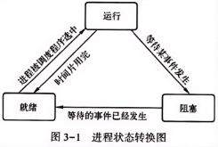

37、五状态进程模型P89

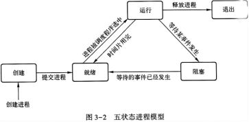

38、在七状态进程模型中，新引入的状态转换有<u>【挂起和激活】</u>两类，意义有变化的转换有<u>【事件出现和进程提交】</u>两类P91

39、<u>【进程控制块(PCB)】</u>描述了进程的基本情况以及进程的运行变化过程。PCB是进程存在的唯一标志。PCB由调度信息和现场信息组成P92

40、PCB的组织方式包括<u>【线性方式、索引方式、链接方式】</u>；系统中的进程队列通常分为<u>【就绪队列、等待队列、运行队列】</u>P93-94

41、进程队列可以用进程控制块的链接来形成。常用的链接方式有两种：<u>【单向链接和双向链接】</u>P94-95

42、进程有一个从创建到消亡的生命周期，这就需要对进程在整个生命周期中各种状态之间的转换进行有效的控制，称为<u>【进程控制】</u>。进程控制是通过进程控制原语来实现的。<u>【原语】</u>是由若干条指令组成的一个指令序列，用来实现某个特定的操作功能；必须在管态下执行，并且常驻内存。用于进程控制的原语一般有<u>【创建原语、撤销原语、挂起原语、激活原语、阻塞原语、唤醒原语以及改变进程优先级原语】</u>P96

43、线程是进程中的实体，是<u>【CPU调度和分派】</u>的基本单位。每个线程都有一个thread结构，即线程控制块，用于保存自己的私有信息，主要由四个基本部分组成：<u>【一个唯一的线程标识符；描述处理器工作情况的一组寄存器(如程序计数器、状态寄存器、通用寄存器等)的内容；每个thread结构都有两个栈指针：一个指向内核栈，另一个指向用户栈；一个私有存储区】</u>P100-101

44、无论什么进程，都是与内核有关的，是在<u>【内核】</u>支持下进行切换的。线程可分为三类：<u>【用户级线程、内核级线程、混合方式实现的线程】</u>P103-104

45、Pthreads线程库中，创建线程的函数是<u>【pthread_create ()】</u>，终止线程的函数是<u>【pthread_exit ()】</u>P105

46、<u>【协程】</u>是运行在线程之上的轻量级线程，当一个协程执行完成后，可以选择主动退出，让另一个协程运行在当前线程之上P107

47、进程调度：主要功能包括<u>【保存现场、挑选进程、恢复现场】</u>；时机（一般在以下事件发生后要执行进程调度）：<u>【创建进程、任务完成、等待资源、中断发生、运行到时】</u>P112

48、两级调度模型涉及<u>【作业调度和进程调度】</u>，作业调度的主要任务是完成作业从后备状态到执行状态和从执行状态到完成状态的转换。它们之间的关系如图4-1所示P112

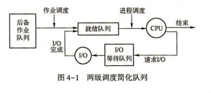

49、三级调度模型在两级调度基础上增加了<u>【中级调度】</u>，负责将内存中驻留时间较长的进程换到磁盘上P113

50、调度策略的选择需考虑<u>【设计目标、公平性、均衡性、统筹兼顾、优先级、开销】</u>等因素P114

51、性能评价标准包括<u>【CPU利用率、吞吐量(表示单位时间内CPU完成作业的数量)、周转时间(从作业提交到作业完成的时间间隔)、就绪等待时间、响应时间(从提交第一个请求到产生第一个响应所用的时间)】</u>P114-115

52、经典进程调度算法P115-121

(1)<u>【先来先服务(FCFS)调度算法】</u>是最简单的一种调度算法，实现思想就是“排队买票”的办法；对长作业(进程)和CPU繁忙型作业较有利，对短作业和I/O繁忙型作业不利

(2)<u>【时间片轮转调度(RR)】</u>主要用于分时操作系统中的进程调度。时间片是一个小的时间单位，通常为<u>【10-100毫秒】</u>；时间片太短会导致<u>【系统开销增加】</u>，太长会退化为先来先服务调度算法；时间片的长短的决定因素：<u>【系统的响应时间、就绪队列进程的数目、进程的转换时间、CPU运行指令速度】</u>

(3)<u>【优先级调度】</u>：进程优先级可由<u>【系统内部定义或外部指定】</u>。两种确定进程优先级的方式：静态方式和动态方式

53、(4)<u>【最短作业优先(SJF)调度】</u>主要用于作业调度。其实现思想：从作业的后备队列中挑选那些需要<u>【运行时间(估计值)最短】</u>的作业放入内存。这是一种非抢占的策略。如果有四个作业A、B、C和D，它们的预计运行时间分别为15和8个时间单位，利用最短作业优先调度，它们的执行顺序是B→A→D→C

(5)<u>【最短剩余时间优先(SRTF)调度】</u>是最短作业优先调度的变形，它采用抢占式策略。当新进程的运行时间比当前进程剩余时间短时，会抢占CPU

(6)<u>【多级队列调度】</u>根据作业特性将其分到不同队列，每个队列有自己的调度算法，队列间采用固定优先级抢占式调度

(7)<u>【多级反馈队列调度】</u>中，高优先级队列时间片小，低优先级队列时间片大，新进程先放入最高优先级队列

54、公平共享调度基于<u>【进程组】</u>进行调度决策，术语“公平共享”表明了这类调度器的基本原则P122

55、保证调度算法向用户做出明确性能保证，如n个用户登录时每个获得<u>【1/n】</u>的CPU处理能力P122

56、<u>【彩票调度算法】</u>是一种概率调度算法，给每个进程分发一定数量的彩票，而调度器则从所有彩票里随机抽取一张彩票，持有该彩票的进程就获得CPU。P122

57、BSD UNIX系统采用了多级反馈队列法，在每个优先级队列中采用了轮转的方法。该系统使用<u>【1秒抢占方式】</u>，每秒都重新计算每个进程的优先级，并且进行一次新的调度决策P123

58、UNIX SVR4调度算法给<u>【实时进程】</u>最高优先权，内核模式进程次高，分时进程最低，有160个优先级P123-124

59、Linux调度采用<u>【抢占式优先级】</u>方式，针对不同进程提供SCHED_FIFO、SCHED_RR、SCHED_OTHER三种策略P124-125

60、Windows调度是抢占式调度器，优先级分<u>【实时和可变】</u>两类，每类16个优先级P126

61、多处理器系统按同步粒度分为<u>【无约束并行性、粗粒度和非常粗粒度并行性、中等粒度并行性、细粒度并行性】</u>P127-128

62、多处理器调度的设计问题包括<u>【把进程分配到处理器、在单个处理器上使用多道程序设计、进程的实际分派】</u>P128

63、在多处理器线程调度和处理器分配的各种方案中，线程调度方法包括<u>【负载分配、组调度、专用处理器分配、动态调度】</u>P130

64、实时调度算法的设计取决于：<u>【一个系统是否执行可调度性分析；如果执行，它是静态的还是动态的；分析结果自身是否根据在运行时分派的任务产生一个调度或计划】</u>P132

65、速率单调调度基于任务的<u>【周期】</u>指定优先级，最短周期的任务优先级最高P134

66、<u>【优先级反转】</u>是一种在任何基于优先级的可抢占的调度方案中都能发生的现象，它与实时调度的上下文关联特别大P134

67、理想存储部件需要具有高速、海量和非易失的特性，任何一种存储部件都无法在速度与容量两个方面同时满足用户的需求。为解决这些矛盾，采用如图5-1所示的存储体系P140

68、程序需要有一个可以长久存放的外存空间，通常是<u>【磁盘】</u>；程序能够快速运行的条件是<u>【处理器能够直接访问】</u>。内存空间分为两部分：系统区和用户区。内存管理主要包括<u>【内存管理方法、内存的分配和释放算法、虚拟存储器的管理、控制内存和外存之间的数据流动方法、地址变换技术、内存数据保护与共享技术等】</u>P140-141

69、在计算机操作系统中，通过引入<u>【分配表格(统称为内存分配表)】</u>来管理内存，通常采用的组织方式包括位示图表示法(用1位(bit)表示一个内存块的状态，0表示空闲，1表示占用)、链表法。内存分配方式包括静态分配和动态分配P141-142

70、存储器以<u>【字节(每个字节为8个二进制位)】</u>为编址单位，每个字节都有一个地址与其对应。假定存储器的容量为n个字节，其地址编号顺序为0，1，2，…，n-1。这些地址称为内存的“绝对地址”，与绝对地址对应的内存空间称为“物理地址空间”P143

71、分区管理方案的基本思想是<u>【把内存划分成若干个连续区域，称为分区，每个分区装入一个运行程序】</u>。分区的方式：固定分区和可变分区P145

72、固定分区中存在的不可再利用的内存空间称为<u>【内碎片】</u>P146

73、小空闲块的每一块都很小，不足以满足程序分配内存的要求，但其总和却可以满足程序的分配要求，这些空闲块很像碎片，于是将这种操作系统知晓的（在内存分配链表中有记录），可以分配但区域很小的空闲空间称为<u>【外碎片】</u>。解决外碎片问题的方法是<u>【内存紧缩技术】</u>，采用紧缩技术时要注意：会增加系统的开销；移动是有条件的P147-148

74、分区保护的方法：<u>【系统设置界限寄存器；保护键方法】</u>P152

75、<u>【覆盖技术】</u>是指一个程序的若干程序段，或几个程序的某些部分共享某一个存储空间；是用户程序自己附加的控制；可以从用户级解决内存小装不下程序的问题P153

76、交换技术中，进程从内存移到磁盘再移回内存的过程称为<u>【交换】</u>，外存的后备存储区称为<u>【盘交换区】</u>P154

77、虚拟存储技术的基本思想是利用大容量的外存来扩充内存，产生一个比有限的实际内存空间大得多的、逻辑的虚拟内存空间，简称<u>【虚存】</u>。虚拟存储器的容量主要是受<u>【地址空间字长和外存容量】</u>所限。实现虚拟存储器需要以下硬件的支持：系统有容量足够大的外存；系统有一定容量的内存；最主要的是，硬件提供实现虚-实地址映射的机制P156-157

78、虚拟页式存储管理中，虚拟地址由<u>【虚拟页号和页内地址】</u>组成P157

79、页式存储管理中，内存分配表可用<u>【位示图】</u>表示，每一位与一个物理页面对应，每一位的值可以是0或1，0表示对应的物理页面为空闲，1表示已占用。假设内存的可分配区域被分成256个物理页面，则可用字长为32位的8个字作为位示图。计算物理页面号：<u>【物理页面号=字号×字长+位号】</u>。根据归还的物理页面号i，计算对应位置：<u>【字号= i /字长，位号= i mod字长 】</u>P158

80、<u>【页表】</u>是硬件进行地址转换的依据，每执行一条指令，就按虚拟地址中的页号查页表。若页表中无此页号，则产生一个<u>【“地址错”程序性中断事件】</u>。若页表中有此页号，则可得到对应的物理页面号，按计算公式可转换成访问的内存的物理地址。物理地址的计算公式为：<u>【物理地址=物理页面号×块长+页内地址】</u>P159

81、在虚拟页式存储管理中，页表项的设计包括：<u>【物理页面号、有效位、访问位、修改位、保护位】</u>P159

82、利用高速缓冲存储器存放当前访问最频繁的少数活动页面的页号，这个高速缓冲存储器称为<u>【“转换检测缓冲区”(TLB),在其他书中也称为“快表”】</u>P161

83、若在页表中发现所要访问的页面不在内存，则产生<u>【缺页异常】</u>P162

84、虚拟存储器系统通常定义三种策略来规定如何(或何时)进行页面调度：<u>【调入策略、置页策略、置换策略】</u>P163-164

85、在虚存中，页面可能在内存与外存之间频繁调度，有可能出现<u>【抖动或颠簸】</u>。颠簸是由于缺页率高而引起的。采用<u>【工作集模型】</u>，可以解决颠簸问题。从时刻t-△到t之间进程访问页面的集合称为工作集，△为工作集窗口。工作集是随时间变化的，如图5-21所示。工作集大小与窗口尺寸密切相关P169-170

86、文件可以被解释为一组带标识的、在逻辑上有完整意义的信息项的<u>【序列】</u>。这里所谓“标识”是指文件名，“信息项”构成了文件的内容。文件内容的具体意义，则由文件的建立者解释P177

87、<u>【文件系统】</u>是操作系统中一种统一管理信息资源的软件。它管理文件的存储、检索、更新，提供安全可靠的共享和保护手段，并且方便用户使用P178

88、外存储设备的存储介质P179-181

(1)<u>【磁带】</u>：是最早使用的磁记录存储介质，是一种顺序存取设备，信息是顺序读写的，后面的信息总是晚于前面的信息出现。存储容量大，但存取速度太慢

(2)<u>【磁盘】</u>：是一种典型的随机存取设备，允许文件系统可以直接存取磁盘上的任意物理块。单张磁盘外表看起来就像一张唱片，也称为盘片。物理地址形式为：<u>【柱面号(磁道号)、扇区号、磁头号(盘面号)】</u>。一次访问磁盘的时间由寻道时间(也称为寻找时间)、旋转定位时间和信息传输时间组成

(3)<u>【光盘】</u>：利用在激光的作用下特性发生变化的一些材料所制成的非磁记录介质

(4)<u>【闪存】</u>：非易失存储器的一种

89、文件常用的存取方法有<u>【顺序存取和随机存取】</u>，下图展示了文件结构、文件存取方式与文件存储介质的关系P181-182

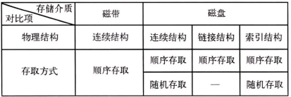

90、文件的分类P182-183

(1)按文件的用途分类：<u>【系统文件、库函数文件、用户文件】</u>

(2)按文件的组织形式分类：<u>【普通文件、目录文件、特殊文件】</u>

(3)UNIX类操作系统中文件的分类：<u>【普通文件(由内部无结构的一串平滑的字符组成的文件)、目录文件(由文件目录项构成的文件)、特殊文件(把I/O设备看成一种特殊文件)】</u>

91、设计文件逻辑结构的原则：<u>【易于操作、查找快捷、修改方便、空间紧凑】</u>P184

92、链接结构的典型代表是<u>【FAT文件系统】</u>P188

93、文件系统的一个特点是<u>【“按名存取”】</u>,即用户只要给出文件的符号名就能方便地存取在外存空间的该文件中的信息，而不必了解和处理文件的具体物理地址。文件控制块(FCB)是系统为管理文件而设置的一个<u>【数据结构】</u>，是文件存在的标志P191

94、文件目录结构一般有<u>【一级目录结构】</u>、<u>【二级目录结构】</u>和<u>【多级目录结构】</u>P192

95、文件系统向用户提供的一个当前正在使用的目录，称为<u>【当前目录】</u>(又称 “工作目录”)P196

96、磁盘空间管理中，常用的磁盘空间分配与回收算法有<u>【位示图】</u>、<u>【空闲块表】</u>和<u>【空闲块链表】</u>P200-201

97、UNIX系统采用<u>【空闲块成组链表】</u>方式管理空闲块P202

98、把若干个逻辑记录合成一组存放一个物理块的工作称为<u>【记录的成组】</u>，每块中的逻辑记录个数称为“块因子”。从一组逻辑记录中把一个逻辑记录分离出来的操作称为<u>【“记录的分解”】</u>P208-209

99、<u>【文件共享】</u>是指一个文件可以允许多个用户共同使用。好处：节省文件所占用的存储空间；免除系统复制文件的工作；减少用户大量重复性劳动；减少实际输入输出文件的次数；可以实现进程间的相互通信P212

100、输入输出设备(I/O设备)也称为外部设备,包括计算机系统中除<u>【CPU和内存储器】</u>以外的所有的硬件设备和装置P222

101、输入输出设备的分类P223-225

(1)按设备的使用特性分类，分为<u>【输入设备、输出设备、交互式设备、存储设备(特性：可写入性、可读出性、可保存性)】</u>

(2)按设备的信息组织方式分类，分为<u>【字符设备和块设备】</u>

(3)按设备使用时可共享性分类，分为<u>【独占设备、共享设备、虚拟设备】</u>

102、每个设备控制器都有若干个寄存器用来与CPU进行通信，包括<u>【控制寄存器、状态寄存器和数据寄存器】</u>。I/O端口地址主要有两种编址方式：内存映射编址和I/O独立编址P226

103、一般的I/O软件结构分为四层：<u>【中断处理层、设备驱动层、设备独立层和用户层】</u>P227

104、设计I/O软件的一个最关键的目标是<u>【设备独立性】</u>P228

105、常见的设备独立层软件实现的一些功能包括：<u>【向用户层并提供一个统一的接口；设备命名；设备保护；提供一个与设备无关的逻辑块；缓冲；存储设备的块分配；独占设备的分配和释放；错误处理】</u>P229-230

106、I/O设备的控制方式取决于<u>【I/O设备硬件与处理器和内存的联结方式，以及其相应的设备驱动程序】</u>，主要有以下四种P230-234

(1)<u>【程序直接控制方式】</u>也称为PIO方式，是指由用户进程直接控制处理器进行内存和外部设备之间信息传送的方式，也称为“忙-等”方式、轮询方式或循环测试方式，这种方式的控制者是用户进程

(2)<u>【中断控制方式】</u>。中断是一种在发生了一个异常事件时，调用相应处理程序(通常称为中断服务程序)进行服务的过程

(3)<u>【DMA控制方式】</u>：是一种完全由硬件执行I/O数据交换的工作方式，DMA控制器从CPU完全接管对总线的控制，数据交换不经过CPU,而直接在内存和外部设备之间进行

(4)<u>【通道控制方式】</u>：按照信息交换方式的不同，一个系统中可以设立三种类型的通道：选择通道、数组多路通道、字节多路通道

107、在设备分配算法的实现中，常采用的数据结构主要含四张表：<u>【系统设备表(SDT)、设备控制表(DCT)、控制器控制表(COCT)、通道控制表(CHCT)】</u>，如图7-9所示P235

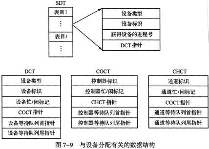

108、设备分配方式有两种，即<u>【静态分配和动态分配】</u>；分配策略通常采用<u>【先来先服务(FIFO)和高优先级优先】</u>等P236

109、系统为每一台设备确定的编号称为设备的<u>【绝对号】</u>；用户在程序中定义的设备编号称为设备的<u>【相对号】</u>。指定设备的方式可以有两种：指定设备的绝对号；指定设备类、相对号P236-237

110、独占设备通常是指打印机、磁带机、扫描仪、绘图仪等，这类设备在一段时间内只能由<u>【一个进程】</u>所占有P237

111、执行一次磁盘输入输出操作所花的时间P240

(1)<u>【寻道时间】</u>，磁头在磁臂带动下移动到指定磁道(柱面)所花的时间

(2)<u>【延迟时间】</u>，需要访问的扇区旋转到磁头下所需的时间

(3)<u>【传送时间】</u>，由磁头进行读写以完成信息传送的时间

112、常用的移臂调度算法有<u>【先来先服务调度算法、最短寻道时间优先调度算法、电梯调度算法、单向扫描调度算法】</u>，它们的优缺点比较如下图：P242-244

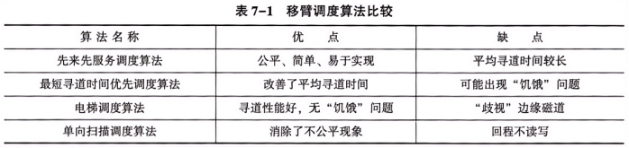

113、根据系统设置的缓冲区的个数，可把缓冲技术分为<u>【单缓冲、双缓冲、多缓冲以及缓冲池】</u>P246

114、并发进程因共享公共变量导致计算结果与执行速度相关的错误称为<u>【与时间有关的错误】</u>P255

115、由于多进程在操作系统中的并发执行，因此它们之间存在着相互制约的关系。竞争资源就是进程间的<u>【互斥关系】</u>，使用其他进程生成的数据就是进程间的<u>【同步关系】</u>P256

116、解决进程同步与互斥问题的方法有两种：<u>【一是由竞争各方平等协商；二是引入进程管理者，由管理者来协调竞争各方对互斥资源的使用】</u>P257

117、在多进程系统中，可把进程间的相互制约关系按相互感知程度分成如表8-1所列的三种类型。可以把计算机系统中资源共享的程度分成三个层次：<u>【互斥、死锁、“饥饿”】</u>P257

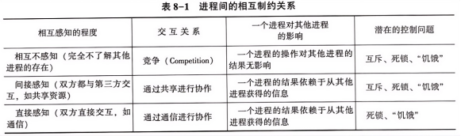

118、通过平等协商方式实现进程互斥的最初方法是<u>【软件方法】</u>。<u>【彼得松算法】</u>是一种软件实现的临界区访问算法，其做法是先修

改临界区标志，再检查，最后修改者等待P258

119、进程互斥的硬件方法依据所采用的指令的不同分成<u>【TS指令和Swap指令】</u>两种。TS指令的功能是读出指定标志后把该标志设置为<u>【TRUE】</u>。Swap指令的功能是交换两个字(字节)的内容P258-259

120、信号量就是由操作系统提供的管理公有资源的有效手段。信号量代表<u>【可用资源实体的数量】</u>。信号量只能通过初始化和两个标准的原语(即P原语和V原语)来访问。信号量机制中的P原语相当于进入区操作，V原语相当于退出区操作。P原语所执行的操作可用下面的函数wait(s)来描述，见程序8-5；V原语所执行的操作可用下面的函数signal(s)来描述，见程序8-6。P259-260

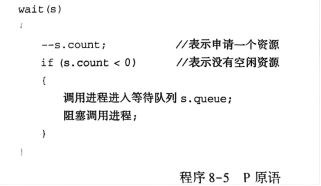

121、对生产者-消费者问题中的同步互斥关系进行分析，并设置相应的信号量。显然，P进程不能往已经“满”的缓冲区中放入产品，设置信号量<u>【empty】</u>，其初值为1，用于指示空缓冲区数量；同样，Q进程也不能从已经“空”的缓冲区中取出产品，设置信号量full,初值为0,用于指示满缓冲区数量P261

122、多个生产者-消费者问题P262-263

(1)同步问题：P进程不能往“满”的缓冲区中放产品，设置信号量empty,初值为k,用于指示缓冲池中空缓冲区数目。Q进程不能从“空”的缓冲区中取产品，设置信号量full，初值为0，用于指示缓冲池中满缓冲区数目

(2)互斥问题：设置信号量mutex，初值为1，用于实现临界区(环形缓冲池)的互斥。另设整型量i、j，初值均为0。i用于指示空缓冲区的头指针；j用于指示有产品的满缓冲区的头指针

123、<u>【死锁】</u>是指在多道程序系统中的一种现象，一组进程中的每一个进程均无限期地等待被该组进程中的另一个进程所占有且永远不会释放的资源。系统发生这种现象称为系统处于死锁状态，简称死锁。处于死锁状态的进程称为死锁进程P265

124、产生死锁的原因主要有两个：<u>【一是竞争资源，系统资源在分配时出现失误，进程间对资源的相互争夺而造成僵局；二是多道程序运行时，进程推进顺序不合理】</u>P265

125、死锁产生的必要条件：<u>【互斥条件、不可剥夺条件、请求和保持条件、循环等待条件(环路中每一个进程已占有的资源同时被另一个进程所申请，即前一个进程占有后一个进程所请求的资源)】</u>P268

126、哲学家就餐问题是操作系统中关于<u>【进程同步与互斥】</u>的经典问题，也是涉及死锁的关键问题P274

二、简答题+综合题(相关知识点)1、操作系统的功能P31-34

(1)<u>进程管理</u>：又称为处理器管理。实质是对中央处理器进行管理，包括进程控制、进程同步、进程间通信、调度

(2)<u>存储管理</u>：任务是管理计算机内存资源，包括内存的分配与回收、存储保护、内存扩充(借助虚拟存储技术)

(3)<u>文件管理</u>：任务是有效地支持文件的存储、检索和修改等操作，解决文件的共享、保密和保护问题，以使用户方便、安全地访问文件。包括：文件存储空间的管理、目录管理、文件系统的安全性

(4)<u>设备管理</u>：是指计算机系统中除了CPU和内存以外的所有输入、输出设备的管理。由操作系统的设备管理功能负责外部设备的分配、启动和故障处理，用户不必详细了解设备及接口的技术细节，就可以方便地通过操作系统提供的设备管理手段，对设备进行操作

(5)<u>用户接口</u>：提供面向用户使用的交互接口，包括命令接口和应用程序接口

2、分布式操作系统与网络操作系统的区别P44

(1)网络操作系统<u>可以构架于不同的操作系统之上</u>，也就是说，它可以在不同的本机操作系统上通过网络协议实现网络资源的统一配置。在网络操作系统中，并不要求透明地访问网络资源，即需要显式地指明资源位置与类型，对本地资源和异地资源访问区别对待。

(2)分布式操作系统<u>强调单一操作系统对整个分布式系统的管理、调度</u>。在这种操作系统中，网络的概念在应用层被淡化了，对于所

有资源，无论是本地的还是异地的，都用统一方式管理与访问，用户不必关心资源所在的真正物理位置，或者是如何存储的。

3、常见的操作系统体系结构P50-53

(1)<u>整体式结构</u>：首先确定操作系统的总体功能，然后将总体功能分解为若干个子功能，实现每个子功能的程序称为模块。再按照功能将上述每个大模块分解为若干个较小的模块，如此下去，直至每个模块仅包含单一功能或联系紧密的小功能为止，即分解为最基本的模块为止。最后通过接口将所有模块连接起来形成一个整体。把这种操作系统的结构称为模块组合结构。主要优点：结构紧密、接口简单直接、系统效率较高。缺点：模块间转接随意，各模块互相牵连，独立性差，系统结构不清晰；数据基本上作为全程量处理，系统内所有模块的任一程序均可对其进行存取和修改，从而造成各模块间有着更为隐蔽的关系；模块组合结构常以大型表格为中心，为保证数据完整性，往往采用全局中断办法，从而限制了系统的并发性，可适应性比较差

(2)<u>层次式结构</u>：就是把操作系统的所有功能模块，按功能流图的调用次序，分别排列成若干层，各层之间的模块只能是单向依赖或单向调用(如只允许上层或外层模块调用下层或内层模块)关系。优点是结构清晰、可靠性高、易于调试、修改、扩充和维护；缺点是全序层次关系难建立，无法完全避免循环现象

(3)<u>客户/服务器(微内核)结构</u>：包括运行在内核态的微内核和运行在用户态的服务进程层。优点是可靠、灵活、适合分布式处理；缺点是微内核本身就成为系统瓶颈，影响效率

(4)<u>外核结构</u>：是一种操作系统结构，内核负责的主要工作仅仅为简单的申请操作以及释放和复用硬件资源，以往操作系统提供的抽象全部在用户空间中运行。这种方式实现了应用级资源管理，即由应用程序而不是操作系统管理硬件资源

4、操作系统的引导方式、引导过程、启动机制P55

(1)<u>引导方式：包括BIOS引导和UEFI引导</u>。BIOS是一个程序，存储在BIOS芯片中。当计算机启动时，BIOS会执行硬件自检并初始化硬件配置。接下来，BIOS会根据CMOS中用户指定的硬件启动顺序，读取相应设备的启动或引导记录，引导相应设备上的操作系统启动。BIOS引导使用MBR(主引导记录)分区方案，且只能在16位实模式下运行。UEFI是一种新型固件接口，它是采用模块化、高级语言(主要是C语言)构建的一个小型化系统。它直接利用加载EFI驱动的方式，识别系统硬件并完成硬件初始化。UEFI引导使用GPT(GUID磁盘分区表)分区方案，且可以在32位或64位模式下运行

(2)<u>引导过程</u>：指将存放在硬盘上的静态的操作系统装载到内存中，并开始执行操作系统的过程，即计算机开机时，BIOS会进行自检并检测出第一个能够引导系统的设备，比如硬盘或光驱。然后运行放在MBR扇区里的启动程序，例如GRUB引导程序。GRUB引导程序通过读取配置文件来获取内核和镜像文件系统的设置及路径位置。接着把内核和镜像文件系统加载到内存中，最后加载硬件驱动程序，以及初始化进程

(3)操作系统的启动机制：<u>BIOS自检、系统引导、启动内核、初始化系统</u>

5、处理器状态(内核态和用户态)的特点及转换方式P62​

(1)<u>内核态</u>：又称为管态、特权态、系统态或核心态，是操作系统管理程序运行时的状态，具有较高特权级别，可执行全部指令(包括特权指令)，可使用所有资源，并能改变处理器状态。<u>用户态</u>：又称为目态、普通态，是用户程序运行时的状态，具有较低特权级别，只能执行非特权指令​

(2)转换方式：<u>用户态到内核态的转换唯一途径是中断</u>；<u>内核态到用户态的转换可通过设置PSW指令(修改程序状态字)实现</u>。系统启动时CPU初始状态为内核态，装入操作系统程序，操作系统退出时让用户程序在用户态执行

6、中断系统的工作过程P69-71

(1)<u>中断请求的接收</u>：由硬件中断装置的中断逻辑线路接收中断信号，寄存在中断寄存器中，按中断优先级判定响应哪个请求

(2)<u>中断响应</u>：工作过程是：①处理器接收中断信号；②保护现场，将中断点的程序状态字(PSW)和程序计数器(PC)值存入系统堆栈；③<u>分析中断向量</u>，取得中断处理程序的入口地址；④将处理器的PC值置为中断处理程序的入口地址；⑤调用中断处理程序

(3)<u>中断处理</u>，过程：①设备给处理器发送一个中断信号；②处理器处理完当前指令后响应中断；③理器处理完当前指令后检测到中断，判断出中断来源并向发送中断的设备发送确认中断信号，确认信号使得该设备将中断信号恢复到一般状态；④处理器开始为软件处理中断做准备：保存中断点的程序执行上下文环境(中断处理后从中断点恢复被中断程序执行的必要信息)；⑤处理器根据中断源查询中断向量表，获得与该中断相联系的处理程序入口地址，并将程序计数器置成该地址，处理器开始一个新的指令周期，结果是控制转移到中断处理程序；⑥中断处理程序开始工作，其中包括检查I/O相关的状态信息、操纵VO设备或者在设备和内存之间传送数据等；⑦在中断处理结束时，处理器检测到中断返回指令，被中断程序的上下文环境从系统堆栈中恢复。处理器状态恢复成原来的状态；⑧程序状态字和程序计数器被恢复成中断前的值，处理器开始一个新的指令周期，中断处理结束

7、时钟的作用P78-79

(1)在多道程序环境中发现陷入死循环的作业，防止浪费机时

(2)在分时系统中用时钟间隔来实现各个作业按时间片轮转运行

(3)在实时系统中。按要求的时间间隔输出正确的时间信号给相关的实时控制设备

(4)定时唤醒那些要求按照事先给定的时间执行的各个外部事件

(5)记录用户使用各种设备的时间和记录某外部事件发生的时间间隔；记录用户和系统所需的绝对时间，即年、月、日

8、系统调用与一般过程调用的区别P80-81

(1)<u>运行在不同的状态</u>：一般过程调用的调用程序和被调用程序运行在相同状态：内核态或用户态；系统调用中调用程序运行在用户态，被调用程序运行在内核态

(2)<u>状态转换不同</u>：一般过程调用不涉及状态转换；系统调用需通过软中断机制从用户态转换为内核态，经操作系统核心分析后转向处理子程序

(3)<u>返回问题不同</u>：一般过程调用执行完后返回调用过程；采用抢占式调度的系统中，系统调用执行完后需分析进程优先级，可能重新调度

(4)<u>嵌套调用</u>：两者都允许嵌套调用，但系统对嵌套调用深度有一定限制

9、系统调用的处理过程P82

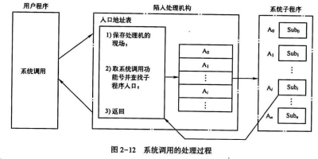

10、进程与程序的联系和区别P87

(1)联系：<u>程序是进程的组成部分之一</u>，一个进程的运行目标是执行它所对应的程序，如果没有程序，进程就失去了其存在的意义。从静态的角度来看，进程是由程序、数据和进程控制块(PCB)三部分组成的

(2)区别：<u>程序是静态的、永久存在(这里不讨论人为删除程序等行为)的；进程是动态的、暂时存在的，有生命周期</u>；一个进程可包含多个程序的执行，一个程序可产生多个进程

11、创建原语、撤销原语、阻塞原语、唤醒原语的主要操作过程P96-97

(1)<u>创建原语</u>：先申请一个空闲PCB区域，然后将有关信息填入PCB,置该进程为就绪状态，最后把它插入就绪队列中

(2)<u>撤销原语</u>：找到要被撤销进程的PCB,将该进程从所在队列中消去，撤销属于该进程的一切“子孙进程”,释放被撤销进程所占用的全部资源，并消去被撤销进程的PCB

(3)<u>阻塞原语</u>：由于进程正处于运行状态，因此首先应中断CPU的执行，把CPU的当前状态保存在PCB的现场信息中，然后把进程的当前状态置为阻塞状态，并把它插入该事件的等待队列中

(4)<u>唤醒原语</u>：在等待队列中找到该进程，将该进程的当前状态置为就绪状态，然后将它从等待队列中撤出并插入就绪队列中排队，等待调度执行

12、线程与进程的主要区别P101-102

(1)<u>调度</u>：线程是CPU调度基本单位，进程是资源分配基本单位

(2)<u>并发性</u>：在引入线程后，操作系统的并发性变得更强

(3)<u>资源</u>：只有进程才可以拥有资源，一个进程中的所有线程共享进程拥有的资源。线程不拥有自己的系统资源(实际上也拥有少量必不可少的资源),但它可以访问其隶属进程的资源

(4)<u>开销</u>：线程调度的系统开销远小于进程调度的系统开销

13、用户级线程和内核级线程的优缺点P103-104

(1)<u>用户级线程</u>

优点：线程的切换速度很快，无须进行系统调度；调度算法可以是应用程序专用的；用户级线程可以运行在任何操作系统上，包括不支持线程机制的操作系统

缺点：系统调用的阻塞问题；无法利用多处理器

(2)<u>内核级线程</u>

优点：在多处理器系统中，内核可以同时调度同一进程中的多个线程，真正实现并行操作；如果一个进程的某个线程阻塞了，则内核可以调度同一个进程中的另一个线程；内核级线程本身也可以是多线程的

缺点：控制转移开销大；调度算法由内核确定，应用进程无法影响线程的切换

14、进程调度的主要任务及为何能把一台物理机变成多台逻辑上的处理机P111

(1)任务是<u>控制、协调进程对CPU的竞争</u>，按照一定的调度算法，使某一就绪进程获得<u>CPU的控制权</u>，<u>转换成运行状态</u>。进程调度也叫低级调度。实际上，进程调度完成的是<u>将一个物理的CPU转变成多个虚拟的(或逻辑的)CPU的工作</u>

(2)<u>进程调度程序是操作系统的真正核心，它直接负责CPU的分配</u>。系统中所有进程都是在CPU上运行的，进程调度程序就是它们的切换开关。如果把硬件CPU看成一台裸机，那么加上这个调度程序之后，就变成多台逻辑上相同的CPU,只是速度慢一些。在有些机器上，甚至用微程序设计把这个程序装入只读存储器(ROM)中，从而提高了CPU的调度效率

15、周转时间的计算P114-115从一个特定作业的观点出发，最重要的准则是完成这个作业要花费多长时间。从作业提交到作业完成的时间间隔就是周转时间。周转时间是用于作业等待进入内存、进程在就绪队列中等待、进程在CPU上执行和完成I/O操作所花费时间的总和。

(1)作业i的周转时间公式为<u>【Ti=tci-tsi】</u>，其中Tsi表示作业i的提交时间，TCi表示作业i的完成时刻

(2)系统中n个作业的平均周转时间为

(3)带权周转时间公式为<u>【W=T/R】</u>，其中T为周转时间，R为实际运行时间

平均带权周转时间为：

16、4类通用的实时调度算法P132

(1)<u>静态表驱动调度算法</u>：执行关于可行调度的静态分析。分析的结果是一个调度，它用于确定在运行时一个任务何时必须开始执行

(2)<u>静态优先级驱动抢占调度算法</u>：同样执行一个静态分析，但是没有指定调度，而且用于给任务指定优先级，使得它可以使用传统的优先级驱动的抢占式调度器

(3)<u>基于动态规划调度算法</u>：在运行时动态地确定可行性，而不是在开始运行前离线确定。一个到达的任务，只有当能够满足它的时间约束时，才可以被接受执行。可行性分析的结果是一个调度或规划，可用于确定何时分派这个任务

(4)<u>动态尽力调度算法</u>：不执行可行性分析。系统试图满足所有的最后期限，并终止任何已经开始运行但错过最后期限的进程

17、存储管理的主要任务P141-143

(1)<u>内存的分配和回收</u>：功能包括记住每个内存区域的状态，实施分配、回收

(2)<u>内存共享</u>：使多个进程共用内存相同区域，包括代码和数据共享，目的：通过代码共享节省内存空间，提高内存利用率；通

过数据共享实现进程通信

(3)<u>内存保护</u>：保护系统程序区不被用户有意或无意侵犯；不允许用户程序读写不属于自己程序的内存空间，如系统区地址空间、其他用户程序的地址空间，包括地址越界保护和权限保护

(4)<u>“扩充” 内存容量</u>：具体实现是在硬件支持下，软件、硬件相互协作，将内存和外存结合起来统一使用

18、静态重定位和动态重定位的区别P143-145

(1)<u>静态重定位</u>：在程序装入前完成所有逻辑地址到绝对地址的转换，执行过程中无需转换，不支持程序浮动。

(2)<u>动态重定位</u>：程序装入时不转换地址，执行中每条指令的逻辑地址由硬件转换为绝对地址，支持程序浮动，需基址寄存器等硬件支持

19、可变分区的空闲区分配策略/操作系统查找和分配空闲区的三种分配算法P150

(1)<u>最先适应算法</u>：又称顺序分配算法，当接到内存申请时，顺序查找空闲区表，找到第一个满足申请长度的空闲区，将其分割并分配

(2)<u>最优适应算法</u>：当接到内存申请时，查找分区说明表，找到第一个能满足申请长度的最小空闲区，将其分割并分配。此算法最节约空间，因为它尽量不分割大的空闲区；其缺点是可能会形成很多很小的外碎片

(3)<u>最坏适应算法</u>：当接到内存申请时，查找分区说明表，找到能满足申请要求的最大空闲区。该算法的基本思想：在大空闲区中装入信息后，分割剩下的空闲区相对也很大，还能用于装入其他程序。优点是可以避免形成较小的、琐碎的外碎片；缺点是分割了大的空闲区后，如果再遇到较大的程序申请内存，则无法满足要求的可能性较大

20、分区的回收P150-152

(1)<u>有上邻空闲区</u>：若空闲区表中第i栏 “起始地址+长度”=S，则第i栏起始地址不变，长度=原长度+ L，合并为一个空闲区

(2)<u>有下邻空闲区</u>：若S+L =空闲区表第i栏起始地址，则第i栏起始地址= S，长度=原长度+ L，合并为一个空闲区

(3)<u>上下邻都有空闲区</u>：若S =第i栏 “起始地址+长度”且S+L =第k栏起始地址，则第i栏起始地址不变，长度= i栏原长度+ k栏长度+ L，第k栏置为 “空”，三区域合并

(4)<u>无相邻空闲区</u>：在空闲区表找 “空” 登记栏，填入S和L，标志改为 “未分配”

21、分区管理方案的优缺点P152-153

(1)<u>优</u>：分区管理是实现多道程序设计的一种简单易行的内存管理技术。通过分区管理，内存真正成为共享资源，有效利用了处理器和I/O设备，从而提高了系统的吞吐量和缩短了周转时间。分区内存管理算法比较简单，所采用的表格不多，实现起来比较容易，内存额外开销较少，内存保护措施也很简单。在内存利用率方面，可变分区的内存利用率比固定分区高

(2)<u>缺</u>：内存使用仍不充分，并且存在着较为严重的外碎片问题；分区管理不能为用户提供“虚存”,即不能实现对内存的“扩充”,每一个用户程序的存储要求仍然会受到物理存储器实际内存容量的限制。分区管理要求运行程序一次全部装入内存之后，才能开始运行。这样，内存中可能含有一些实际不使用的信息

22、虚拟存储技术与交换技术的区别P157

(1)在传统的交换技术中，交换到外存上的对象一般都是进程，也就是说，<u>交换技术是以进程为单位的</u>，如果一个进程所需内存大于当前系统内存，那么该进程就不能在系统中运行

(2)虚拟存储——如虚拟页式存储管理方案——<u>一般是以页为交换单位</u>，所以，如果一个进程所需内存大于当前系统内存，那么该进程仍然可以在系统中正常运行，因为该进程的一部分可以被换出到外存上

23、缺页异常的处理过程P162-163

(1)根据当前执行指令中的逻辑地址查页表的有效位，判断该页是否在内存中

(2)该页标志为<u>“0”</u>,形成缺页异常；保留现场；中断装置通过交换PSW让操作系统的缺页中断处理程序占用处理器

(3)操作系统处理缺页异常，寻找一个空闲的物理页面

(4)若有空闲页，则把磁盘上读出的信息装入该页面中

(5)修改页表及内存分配表，表示该页已在内存

(6)如果内存中无空闲页，则按某种算法选择一个已在内存的页面，把它暂时调出内存

(7)恢复现场，重新执行被中断的指令

24、页面置换算法P165-168

(1)理想页面置换(OPT)算法原理：<u>淘汰以后不再需要的或最长时间后才使用的页面</u>

例：某程序在内存中分配到了三个页面，初始为空，所需页面的走向为4、3、2、1、4、3、5、4、3、2、1、5,采用OPT算法，计算缺页次数

说明：最长时间以后才会用到的页面用“时间长-页”表示，“时间中-页”其次，“时间短-页”表示最短时间会用到的页面。

缺页次数：7次

(2)先进先出(FIFO)算法原理：<u>把装入内存的那些页面的页号按进入的先后次序排好队列，每次总是调出队首的页，当装入一个新页后，把新页的页号排到队尾。由操作系统维护一个所有当前在内存中的页面的链表，最老的页面在表头，最新的页面在表尾。当发生缺页时，淘汰表头的页面并把新调入的页面加到表尾</u>。图5-20是先进先出页面置换算法示例。其中D表示某进程已分配页面页号队列的起始位置


在图5-20中，指针K指示页面1,表示页面1是最早装入内存的页面，现在需要调入页面6,于是页面1被换成页面6,而指针K加1,指出下一次可调出的页，即页面3

这里指针K是循环指针，假定页号队列中有n个页号，每次调出一页后，执行：K=(K+1)mod n

于是，K指示的位置就是页号队列的队首，而新装入的那页所在的位置就成了队尾

例：某程序在内存中分配到了三个页面，初始为空，所需页面的走向为4、3、2、1、4、3、5、4、3、2、1、5,采用先进先出页面置换算法，计算缺页次数。

在下面的图中，“时间长-页”表示在内存时间最长的页面，“时间中-页”其次，“时间短-页”表示在内存时间最短的页面。

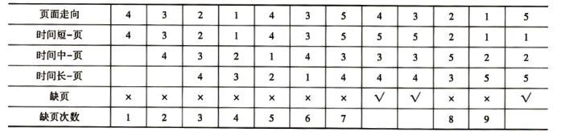

缺页次数：9次

(3)<u>时钟(Clock)页面置换算法</u>：通过环形链表管理页面，当发生缺页时，检查表针指向的页面，如果R=0则置换并将表针前移；如果R=1则清除并移动表针

(4)<u>最近最少使用(LRU)页面置换算法</u>：在缺页发生时，首先淘汰最长时间未被使用的页面。总是先选择距离现在最长时间内没有被访问过的页面将其调出

例：某程序在内存中分配到了三个页面，初始为空，所需页面的走向为4、3、2、1、4、3、5、4、3、2、1、5,采用LRU页面置换算法，计算缺页次数。

同样，在下面的图中，“时间长-页”表示未使用时间最长的页面，“时间中-页”其次，“时间短-页”表示未使用时间最短的页面。

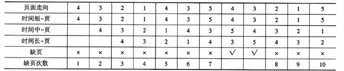

缺页次数：10次25、缺页率P168-169

假定一个程序共有n页，系统分配给它的物理页面是m个(m、n均为正整数，且1≤m≤n)。因此，该程序最多有m页可同时被装入内存。如果程序执行中访问页面的总次数为A,其中有F次访问的页面尚未装入内存，则产生了F次缺页异常。

缺页率：<u>【f=F/A】</u>，其中F为缺页次数，A为访问页面总次数，把f称为缺页率。

影响缺页率的因素：<u>分配给程序的物理页面数；页面的大小；程序编制方法；页面置换算法的性能</u>

26、虚拟页式存储管理的优缺点P169

(1)优：由于它不要求进程的程序段和数据在内存中连续存放，因此有效地解决了碎片问题。这既提高了内存的利用率，又有利于组织多道程序执行

(2)缺：存在页面空间的浪费问题。因为各种程序代码的长度是各不相同的，但页面的大小是固定的，所以在每个程序的最后一页内总会有一部分空间得不到利用，称为内碎片。如果页面较大，则由此引起的存储空间的损失仍然较大

27、文件系统的功能P178

(1)统一管理文件的存储空间，实施存储空间的分配与回收

(2)实现文件从名字到外存地址空间的映射，即实现文件的按名存取，以对用户透明的方式管理文件名

(3)实现文件信息的共享，并提供文件的保护措施

(4)向用户提供一个方便使用的接口(提供对文件系统和文件的操作命令，以及信息存取、加工等)。

(5)系统维护及向用户提供有关信息

(6)保持文件系统的执行效率。文件系统在操作系统接口中所占的比例最大，用户使用操作系统的体验在很大程度上取决于对文件系统的使用效果

(7)提供I/O的统一接口

28、文件的逻辑结构和物理结构的定义及常见类型P184-188

(1)<u>文件的逻辑结构</u>：是面向用户的文件的组织结构，即用户看到的文件的组织结构。常见类型有：流式文件、记录式文件

(2)<u>文件的物理结构</u>：是文件在实际的存储空间存储时的结构。常见类型有：顺序结构、链接结构、索引结构

29、文件控制块包括的内容P191

文件名、文件号、用户名、文件物理位置、文件长度、记录大小、文件类型、文件属性、共享说明、文件逻辑结构、文件物理结构、文件建立日期和时间、最后访问日期和时间、最后修改日期和时间、口令、保存期限等

30、目录分解法P196-197

为加快目录检索，可采用目录项分解法，即把目录项(文件控制块)分为两部分：<u>符号目录项(次部)和基本目录项(主部)</u>。其中，符号目录项包含文件名以及相应的文件号；而基本目录项包含除文件名以外的文件控制块的其他全部信息，参见图6-14

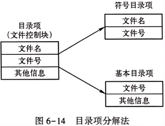

假设一个文件控制块有48个字节，符号目录项占8字节，其中文件名占6字节，文件号占2字节；基本目录项占48-8=40字节。设物理块的大小为512字节。

在进行目录项分解前，一个物理块可以存放512/48≈10个文件控制块。

在进行目录项分解后，一个物理块可以存放512/8=64个符号目录项，或者512/40≈12个基本目录项。

如果一个目录文件有128个目录项，那么分解前128×48/512=12,即需要12个物理块存放该目录文件。

在进行目录项分解后，符号目录项占128×8/512=2个，即需要两个物理块存放符号目录项；基本目录项占128×40/512=10个，即需要10个物理块存放基本目录文件。

下面计算查找一个文件的平均访盘次数：

分解前：(1+12)/2=6.5次

分解后：(1+2)/2+1=2.5次

31、设备管理的任务P223

(1)解决I/O设备性能与CPU性能不匹配的矛盾，主要通过<u>缓冲技术、中断技术和虚拟技术</u>

(2)对I/O设备实现统一管理，提供统一访问接口，实现设备独立性

(3)保证安全、正确地使用设备，确保数据安全，避免设备使用冲突

32、设备管理与文件管理的关系P225-226

(1)设备管理是对<u>计算机系统中所有输入输出设备</u>的管理，也是对资源的管理。它更多地是为用户提供标准的接口来使用这些设备

(2)文件管理针对的是这些<u>设备里面存储的数据与信息</u>，它提供了一整套的对数据信息资源的管理规则，并且以文件及其配套的概念来具体实施

(3)文件管理与设备管理之间明确分工，接口清晰，将物理的设备资源抽象为逻辑的文件资源，使得用户可以用统一、透明的方式访问物理设备和设备上的数据与信息，不必关心两者之间的对应关系。在UNIX系统中，为了便于管理，将所有的设备都当作文件对象来管理

33、通道的功能P234

(1)接受CPU的指令，按指令要求与指定的外部设备进行通信

(2)从内存读取属于该通道的指令，执行通道程序，向设备控制器和设备发送各种命令

(3)组织外部设备和内存之间进行数据传送，提供数据缓存空间，提供数据存入内存的地址和传送的数据量

(4)从外部设备得到设备的状态信息，形成并保存通道本身的状态信息，按要求送到内存指定单元供CPU使用。

(5)将外部设备的中断请求和通道本身的中断请求，按序及时报告CPU

34、磁盘块的编号P240-241

首先是<u>按相同磁道(柱面)的磁头(盘面)顺序(从0号开始编址)</u>,其次是<u>按相同磁道(柱面)的扇区顺序，最后是按磁道(柱面)号的顺序</u>。

在访问时，反过来进行<u>寻址，即先寻道，再等待扇区，最后选择磁头</u>。

假定用t表示每个磁道(柱面)上的磁头总数(或者称为一个柱面上的总磁道数),用s表示每个磁道(柱面)上的扇区数，则第i个磁道、第j个磁头、第k个扇区所对应的块b：

b=k+s×(j+i×t)

同样地，根据块号也可确定该块在磁盘上的位置。在上述假定条件下，每个磁道(柱面)上的磁盘块有s×t个，为了计算第p块在磁盘上的位置，可以令

d=s×t

m=[p|d]

n=p mod d

于是，第p块在磁盘上位置为

柱面号=m

磁头号=[n|s]

扇区号=n mod s

35、旋转调度优化P244

进行旋转调度时应分析下列情况：

(1)若干等待访问者请求访问同一磁道(柱面)上的不同扇区

(2)若干等待访问者请求访问不同磁道(柱面)上的不同编号的扇区

(3)若干等待访问者请求访问不同磁道(柱面)上的、具有相同编号的扇区

<u>对于前两种情况，旋转调度总是为首先到达读写磁头位置下的扇区进行读写操作。</u>

<u>对于第三种情况，由于这些扇区编号相同，又在同一个柱面上，因此它们同时到达读写磁头的位置下。这时，旋转调度可任意选择一个读写磁头进行读写操作</u>

例如，有4个访问第88号柱面的请求者，它们的访问要求如图7-18所示。

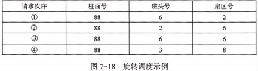

图7-18中的4个访问的执行次序有两种可能：①、②、④、③或①、③、④、②。

36、磁盘信息的优化分布P245

记录在磁道上的排列方式也会影响磁盘的输入输出操作的时间。

例：某磁盘转速为40ms /周，盘面分8个扇区，8个逻辑记录(1-8)按顺序存放在同一磁道(如图7-19a)。

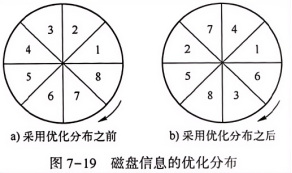

程序读取每个记录需5ms，处理每个记录需10ms，顺序处理时：

读取第1个记录后，处理耗时10ms，此时磁盘已旋转过3个扇区，需等待30ms才能读取第2个记录。

总时间：8×(5+10) + (8-1)×30 = 330ms

优化方案：重新排列记录，使处理完一个记录后，下一个记录恰好旋转到磁头位置(如图7-19b)

总时间：8×(5+10) = 120ms，效率显著提升

37、SPOOLing系统的工作原理P248

SPOOLing系统主要包括<u>输入程序模块、输出程序模块、作业调度程序</u>三部分。其工作原理如下:

(1)利用SPOOLing系统中的输入程序模块，在作业执行前就利用慢速设备将作业预先输入到后援存储器(输入井)中，即预输入

(2)作业进入内存运行后，使用数据时直接从输入井中取出

(3)作业执行时将输出数据写入输出井，即缓输出

(4)待作业全部运行完毕，再由外部设备输出全部数据和信息

38、进程互斥的硬件方法的优缺点P259

(1)优：适用范围广；简单；支持多个临界区

(2)缺：进程在等待进入临界区时，处理机为“忙等”,不能实现“让权等待”；由于进入临界区的进程是从等待进程中随机选择的，有些进程可能一直选不上，从而导致“饥饿”现象

39、读者-写者问题的解决方案P264-265

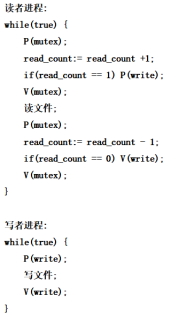

read_count是一个计数器，初值为0。而mutex和write都是信号量，它们的初值都是1。

<u>read_count是一个共享变量，需要互斥使用</u>，在每个读者进入时，对read_count的计数不能出错。另外，如果第一个读者进入，就不能再允许写者进入，这就是“if(read_count =1)P(write)”语句的作用；第一个读者负责禁止任何写者进入。以上这两个操作都要放在互斥区内。

其他的读者可以随着第一个读者的进入而陆续进入。

当有读者完成读操作之后，相应地要对read_count进行减1操作。而且，如果read_count =0,则表明已经没有读者了，写者可以随时进入。

对于读者，只要有一个写者已经在临界区执行写操作，所有的读者就必须等待。

40、死锁避免算法：银行家算法P270-271

假定某系统有三类资源A、B、C,A类资源共有10个资源实例，B类资源共有5个资源实例，C类资源共有7个资源实例，现有5个进程P1、P2、P3、P4、P5,它们对各类资源的最大需求量和第一次分配后已占有的资源量如图8-14所示。

应用银行家算法，找到一个进程安全序列{P2,P4,P5,P3,P1},可以得出结论：图8-14中的系统状态是安全状态。在此状态下，进程P2提出新的资源申请：A类1个、B类0个、C类两个，进行试探性分配后，系统状态如图8-15所示。

应用银行家算法，仍然可以找到一个进程安全序列{P2,P4,P5,P1,P3},表明该系统状态是安全状态，可以真正实施资源分配

在图8-15所示状态下，进程P5又申请资源：A类3个、B类3个、C类0个，此时系统不能实施分配，因为该申请已经超过了系统当前剩余的资源量。若进程P1提出新的资源申请：A类0个、B类两个、C类0个，那么也不能实施资源分配，因为根据银行家算法。若进行了分配，则在新的系统状态下找不到进程安全序列，这将导致系统进入不安全状态

不安全状态并非死锁状态，只是有死锁的可能性。例如，对于图8-15所示新的系统状态，假设不进行试探性分配，而是强行分配的话，系统会进入不安全状态。而此时，并不是所有进程的推进均按最大需求量进行，若发生某进程(例如P5进程)由于内部分支转向某一段代码而不再需要最大资源数(4,3,3)的情况，假设仅需要(3,3,1),那么可以找到安全序列，系统重回安全状态。在这个过程中，系统并未发生死锁。也就是说，不安全状态不一定导致死锁，而是有可能导致死锁

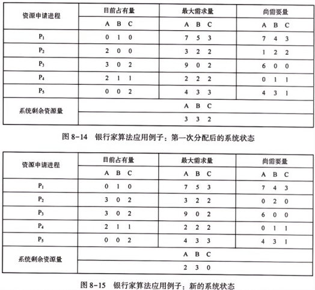

